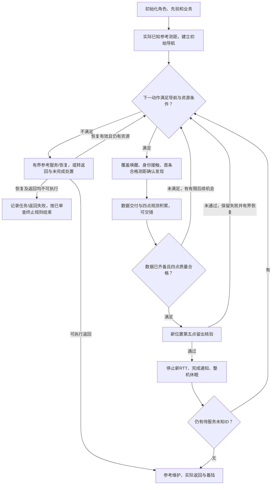

# 论文总纲：当前唯一研究规格

更新：2026-11-24。题目按用户原文保留：**基于啁啾扩频的通感一体化的协议相关技术**。最新应用场景为**GNSS不可用林区的生态监测**。本文件集中保存场景、工作流程、公式修改路线和论文安排；版本差异由Git保留，不另建第二份生效方案。论文原方法、阅读范围和借鉴边界集中在[文献与原理依据](文献与原理依据.md)。

**当前状态：第12节已形成一套有依据、假设明确且有名义可行条件的联合仿真模型；整航次性能尚未验证。** 参数和条件集中在唯一配置的joint_model_candidate；第10—11节保留完整性与条件诊断。MATLAB仍是旧视觉实现，review.json保持任务未放行，本轮不仿真；下一步迁移动态接口与数值保护。

## 1. 最新确认与设计边界

| 内容 | 状态与口径 |
| --- | --- |
| 应用 | 用户已选择林区生态监测；不再采用军用、演训或库区调查作为当前任务 |
| 导航输入 | 已知位置参考终端的CSS测距辅助IMU惯性导航；任务中不使用GNSS，不使用视觉标志 |
| 定位对象 | 多个静止的未知位置生态监测终端；无人机在多个位置测距定位 |
| 平台 | 单无人机；已知参考节点数N_A、未知监测节点数N_U分别登记，不沿用旧总数暗作新角色数量 |
| 路径与交互 | 先生成参考条件支持的初始覆盖路径，沿途周期参考测距和未知节点唤醒；依当航次多终端状态有限调整 |
| 研究重点 | CSS通信、参考测距与未知节点定位的协议及服务调度；航点选择作配套 |
| 创新工作量 | 以一个候选协议/调度主方法为中心；不要求C1/C2/C3分别形成独立创新 |
| 本轮业务策略 | 以临时节点部署验收、少量数据交付及位置登记为初版工作任务；后续常态监测另行唤醒 |
| 节点高度 | 首版地面或低位安装，使用带误差的地形与安装高度先验；不读取真实高程 |
| 首版几何简化 | 参考与未知终端暂按共同名义水平面分析；平面高程/安装残差仍登记，不将UAV高度当已知，尚未冻结正式参数 |
| 飞行与传感器 | 暂按水平面统一名义高度巡航，仅IMU＋CSS；不增加独立测高或视觉 |
| 初始化 | 起飞前提供起降点坐标及初始航向标定，坐标与航向误差登记为先验 |
| 待定模型 | 参考布局及误差、CSS硬件/频段与事务、定高偏离与地形误差、监听窗口、载荷和各门限 |
| 本阶段证据范围 | 用户明确以仿真研究为主，先确认有依据且假设明确的联合模型；实测校准/实飞不是当前硬门槛，仍不启动仿真 |

任务选择GNSS不可用且具备可用无线参考基础设施的林区作业片段。山地/峡谷可作为具体地形实例，但不再将一般峡谷任务当作唯一业务；不推断所有林区均无GNSS。初版建议事先给定可飞行走廊及有限服务候选，不同时增加自主建图、复杂避障或新物理层波形研究。

## 2. 场景与信息来源

已有少量固定生态监测点或预先布设的无线参考终端，其位置在建设/部署时登记，具有测绘误差先验。本次调查为提高空间采样密度，新增一批临时监测节点。它们可通过无人机投送、绳降或人工快速布设，部署后在本航次内静止，但最终位置尚未准确登记。

节点主要交互温湿度等少量生态样本、采样时间、电量、自检状态及测距信息。参考终端必须实际具有所需CSS测距能力，普通监测站不能仅凭坐标已知就被当作可用测距锚点。林区部署环境传感器具有研究依据，例如[森林传感器部署研究](https://research.tudelft.nl/en/publications/sensor-delivery-in-forests-with-aerial-robots-a-new-paradigm-for-/)；该文支持部署业务，不证明本工程的无GNSS/CSS导航性能。

| 对象 | 允许在线使用的信息 | 禁止的替代或推断 |
| --- | --- | --- |
| 已知参考终端 | ID、角色、登记坐标及协方差/共同基准误差、实际收到的状态与测距 | 默认坐标无误差；把未收到的参考观测当成已完成校正 |
| 未知监测终端 | 已登记ID/数量、业务需求、实际应答；合法获得的带误差投放粗位置可作先验 | 直接读取真实落点；刻意丢弃已有粗位置制造“完全未知” |
| 无人机 | 带误差的起始位置/航向、IMU、已知参考测距、允许的地图/走廊先验 | 真位置、真姿态、未来收包结果；用未知节点真值修正导航 |
| 地形与安装高度 | 事先可获得且注明误差的先验，或实际传回的可用安装信息 | 无来源读取每个未知节点真实高程；把落在树冠的节点默认为地表 |

只有新增节点最终位置仍未达到登记要求时，后续定位才有必要。投放粗位置不能直接当成无误差终端坐标。已定位的未知节点不自动升级为导航参考，避免引入无线SLAM和循环证据。

本航次是部署验收：读取部署状态/少量样本、完成位置登记和通知，然后整机休眠。后续采样/读取在另一次唤醒任务中进行；整机休眠期间不继续环境采样，不宣称本航次实现连续生态监测。

## 3. 导航、定位与业务边界

信息链为：**已知参考坐标先验＋真实CSS参考测距→IMU辅助导航→带误差的无人机天线位置及所需联合块→未知节点多位置测距→4＋1定位核验→后续服务航线决策**。

两类终端职责进一步明确：已知参考负责校正无人机惯导误差、抑制累计漂移；未知终端的应答、业务与定位状态驱动下一航点/服务对象选择。未知测距和其位置估计进入任务决策，当前模型不将它们作为无人机位姿滤波观测。航点选择同时服从参考服务、导航质量和实际返回约束。

IMU在移动、监听、通信、测距和计算期间持续传播。只有真正取得、身份匹配且通过在线有效性检查的已知参考观测，才进入导航更新。未知终端测距不反向更新无人机位姿；留出的未知测距原始成分也不得通过时钟校准等路径回灌本轮四点拟合。

一条参考距离不等于完整位置/姿态校正。参考节点布局、观测时效、运动、初始位置/航向及登记误差须联合审查；不能只凭“有若干已知节点”宣称可观。共同坐标偏差不能因增加参考节点或重复测距就独立平均掉。

首版节点采用地面/低位安装和带误差高程先验，主要估计水平坐标；无人机暂按水平面统一名义高度巡航，仅使用IMU＋CSS，保留三维导航误差。名义高度是运动/控制设定，不能作为准确测高观测。起飞前起降点坐标及初始航向标定以带误差先验输入；起飞、着陆及巡航偏离仍需传播。以下将水平面解释为统一任务坐标系下的名义高度，不自动改成随地形变化的固定离地高度。


### 3.1 初始覆盖路径的生成

输入为作业区域Ω、可飞行走廊C、起降点、已知参考坐标及误差、声明的无线服务模型、IMU先验与任务资源。路径不能仅由参考坐标连线得到，也不读取未知终端真实落点。建议在给定走廊/网格上生成往返或蛇形覆盖序列π₀=(q₀,…,q_M)，只比较有限起点/方向与返回连接，不研究全局最优覆盖。

生成时执行四项检查：划分必须获得唤醒机会的覆盖单元；在路径旁标注已知参考可服务的候选位置；逐段预测无新参考观测时的导航误差增长及完整服务时间；连接有条件可执行的回程。参考候选的几何与链路是有误差模型下的预计条件，实际执行仍须收到参考测距后才更新导航。

路径中相邻参考机会之间若无法容纳必要广播/业务事务及下一参考服务，应调整路径或已知参考布设，并重新检查。不得通过清零导航误差、缩短物理包或读取未知节点真值制造可行。覆盖单元“已访问/已提供机会”与“节点已发现”分别记录，走完π₀不证明全部节点发现。

### 3.2 无线参考观测的局部原理

采用既有右乘局部误差约定δp=p_true−p_hat，R_true=R_hat Exp(δθ)。令天线杆臂为ℓ_a，参考登记坐标为a_j，则

$$
p^{ant}=p+R\ell_a,\qquad r_j^A=\|p^{ant}-a_j\|+b_j+\varepsilon_j.
$$

对参考距离d及单位方向u=(p+Rℓ_a−a_j)/d，一阶几何残差为

$$
\delta d=u^T\delta p-u^TR[\ell_a]_\times\delta\theta-u^T\delta a_j.
$$

其余速度/偏置分量通过IMU传播关联；若增广测距偏差，偏差列还需加入。坐标、时钟及设备公共项进入增广状态或统一联合输入，不能既放入导航协方差又重复作为独立测距噪声。上述是非零距离处的局部线性化，不证明完整INS可观；采用普通卡尔曼更新还须明确剩余观测噪声的独立条件。

L2的参考惯导框架与L7的误差状态约定提供基础，L5提示高程/航位误差的作用，具体对应见[文献与原理依据](文献与原理依据.md)。未知终端观测仍为r_i^U=‖p_ant−s_i‖＋误差，只用于其位置估计；参考位置与导航共同平移时距离不变，绝对误差下限须来自坐标先验，不能由4＋1消除。

### 3.3 首轮模型、符号与推导范围

本轮先闭合R01→N01/N02→T01的依赖，再给出L01/V01的相关误差接口。式中数值参数尚未冻结；推导成立不表示林区噪声、链路或整航次性能已验证。文献L2/L3/L7支撑标准基础，L11提醒CSS测距偏差不能只作为白噪声；本题具体组合与下列推导的适用条件由本节说明。

| 符号 | 定义与单位 |
| --- | --- |
| W、B；R | 任务局部坐标系、机体系；R将B向量旋转到W，位置单位m |
| p、v、b_a、b_g | IMU位置(m)、速度(m/s)、加计偏置(m/s²)、陀螺偏置(rad/s) |
| a_j、s_i(x_i) | 已知参考的实际固定坐标、未知节点三维坐标；a_j有登记先验而非无误差真值 |
| H_cmd、z(t) | 巡航名义水平面高度、实际高度(m)；二者不被强制设为已知且完全相等 |
| x_i、g(x_i)、h_i | 未知水平坐标、先验地形高程、名义安装高度；各自注明坐标基准 |
| C_k(t)=α_k t+β_k | 短事务内仿射设备时钟；t、C单位s，α无量纲，β为时钟相位(s) |
| κ=α_A/α_B | UAV/对端的时钟速率比，保持该方向；不与其倒数混用 |
| ζ、Σ_ζ | 共同基准、参考坐标、导航历元、时钟/设备偏差、地形及新白噪声的联合输入与协方差 |

任务中仅IMU与实际CSS参考观测进入导航；起始先验也有来源和协方差。传感器套件不因引用L2而增加气压计。地形/高度先验与参考共同测绘误差可以相关，不默认所有先验相互独立。

### 3.4 R01/R02：时钟、测距与不可平均的误差

先用一个静止两向交换推导接口：A在t₁发送，B在t₂=t₁+d/c接收，于t₃=t₂+τ_B响应，A在t₄=t₃+d/c接收。c为传播速度(m/s)，τ_B为物理响应间隔(s)。完成硬件延时校正后，设备内的时间差满足

$$
D_A=C_A(t_4)-C_A(t_1)=\alpha_A(2d/c+\tau_B),\quad
D_B=C_B(t_3)-C_B(t_2)=\alpha_B\tau_B.
\tag{R01-a}
$$

因此时钟相位β消去，但速率比κ仍须获得；若目标硬件确实提供这些量或其等价测距结果，则

$$
\hat d=\frac{c}{2\hat\alpha_A}(D_A-\hat\kappa D_B).
\tag{R01-b}
$$

该式是计时接口推导，不承诺所有LoRa芯片都开放四个射频时间戳。L3的SX1280主从互换back-to-back方案与旧代码冷校正不是同一事务；首版硬件未选定，只将其列为有实测文献的候选。应按目标引擎重写实际交换/管理回传，再决定怎样取得κ和残差，不能直接把R01-b当成硬件API。

取y=(D_A,D_B,κ,α_A)，一阶误差传播为

$$
J_y=\left[\frac{c}{2\alpha_A},-\frac{c\kappa}{2\alpha_A},
-\frac{cD_B}{2\alpha_A},-\frac{\hat d}{\alpha_A}\right],
\quad \sigma_d^2\simeq J_y\Sigma_yJ_y^T.
\tag{R01-c}
$$

κ与α_A可能共享同一时钟估计，Σ_y须保留其相关项。响应较长会放大κ误差；未知延时、温漂、未校准偏差不能无来源地塞成新的独立白噪声。运动中往返两段不再严格使用同一个d，初版在短停服务中核对运动残差和时间对齐后才使用静止近似。

校正后的等效距离写成r_k=d_k+b_com+b_link+ε_k，两个b是有标定先验/明确演化的公共和链路残差，ε_k才是条件独立的新白噪声。若同址m次均合格、几何在允许范围内不变，且各b在该块内保持共同，则

$$
\bar r=d+b_{com}+b_{link}+\bar\varepsilon,\qquad
\mathrm{Var}(\bar r-d)=\sigma_{com}^2+\sigma_{link}^2+\sigma_\varepsilon^2/m
\tag{R02-a}
$$

仅在这些分量相互独立的条件下成立；一般情况用JΣ_ζJᵀ。跨位置共享偏差仍产生非对角块，不能把所有误差除以m，也不同时在增广状态和白噪声里重复计算同一偏差。逐链路完全自由的未知偏差与距离可能互相混淆，必须有校准先验/可辨识检查，不能靠给每条观测增加任意偏差获得好拟合。

### 3.5 N01/N02：仅IMU＋CSS的参考辅助导航

采用标准15维误差状态δx=(δp,δv,δθ,δb_a,δb_g)，重力g在任务坐标系中给定，R保持第3.2节的右乘局部约定。令f=a_m−b_a、ω=ω_m−b_g，名义传播与一阶误差为

$$
\dot p=v,\quad \dot v=Rf+g,\quad \dot R=R[\omega]_\times,
\tag{N01-a}
$$
$$
\delta\dot p=\delta v,\quad
\delta\dot v=-R[f]_\times\delta\theta-R\delta b_a-Rn_a,\quad
\delta\dot\theta=-[\omega]_\times\delta\theta-\delta b_g-n_g,\quad
\delta\dot b_a=n_{ba},\ \delta\dot b_g=n_{bg}.
\tag{N01-b}
$$

按上述状态顺序，F与按(n_a,n_g,n_ba,n_bg)排列的噪声映射为

$$
F=\begin{bmatrix}
0&I&0&0&0\\
0&0&-R[f]_\times&-R&0\\
0&0&-[\omega]_\times&0&-I\\
0&0&0&0&0\\
0&0&0&0&0
\end{bmatrix},\qquad
L=\begin{bmatrix}
0&0&0&0\\
-R&0&0&0\\
0&-I&0&0\\
0&0&I&0\\
0&0&0&I
\end{bmatrix}.
\tag{N01-d}
$$

每块为3×3；Q_c为这些连续噪声的强度矩阵，保持实际采用的轴向与相关性。按实际移动/等待/完整事务间隔Δt离散：

$$
\Phi=\exp(F\Delta t),\quad
Q_d=\int_0^{\Delta t}e^{Fs}LQ_cL^Te^{F^Ts}\,ds,\quad
P^-=\Phi P^+\Phi^T+Q_d.
\tag{N01-c}
$$

该常系数形式用于短步长内冻结线性化；变化时按实际IMU步积分。二维巡航仍可需要倾斜姿态产生水平加速度，不能因定高删去姿态/偏置误差。地球自转、重力变化等在局部短航次是否可忽略须注明；不把15维式作为任意长时间精确模型。

将有先验的参考参数及选定的设备/公共偏差组成静态或慢变增广状态η；整体误差为δχ=(δx,δη)，初始P保留共同基准块。实际参考观测的H由第3.2节距离导数及偏差列组成；只有身份匹配且实际收到的观测参与。令y=z−h(当前名义状态及参数)，若剩余新噪声ν与δχ独立：

$$
S=HP^-H^T+R_\nu,\quad K=P^-H^TS^{-1},\quad
\widehat{\delta\chi}=Ky,\quad
P^c=P^--P^-H^TS^{-1}HP^-.
\tag{N02-a}
$$

若采用的时间戳处理使剩余噪声仍有D=Cov(δχ,ν)，则相应使用

$$
S=HP^-H^T+HD+D^TH^T+R_\nu,\quad
K=(P^-H^T+D)S^{-1},\quad
P^c=P^--(P^-H^T+D)S^{-1}(HP^-+D^T).
\tag{N02-b}
$$

两种接口选一并解释剩余独立性；不忽略非零D。按p←p＋δp、R←R Exp(δθ)等注入后，误差重置P⁺=G_reset P^c G_resetᵀ；角误差块一阶为I−[δθ_hat]×/2，其余按所选增广坐标定义。式N02-a/b是局部高斯更新，不证明持续NLOS下的一致性；创新门限也不能依据隐藏真实误差筛选。

### 3.6 S01/N02：定高、高程与参考几何的可行边界

H_cmd是名义飞行面。实际z−H_cmd的误差须由起始先验、IMU和参考距离传播/约束；首版不增加气压计或测高观测，也不每隔一段把z重置到命令值。起飞、返回和着陆不因巡航定高被删去。若后续采用定高运动先验，须明确其偏离范围及与控制/IMU的相关性，不能重复当作独立测量。

单历元位置距离雅可比G_A各行为u_jᵀ。若参考与UAV共面且u_j,z=0，高度一阶不受约束；若参考共线，同一时刻G_A秩至多2。地面参考不共线、UAV离开该平面时可以有局部三维位置灵敏度，但地面上下镜像仍可能给出相同距离；合法起始/飞行区域先验用于限定分支，不由真值挑选。

对有协方差V的该批距离，G_AᵀV⁻¹G_A的特征值只作局部几何诊断。参考数达到某个值不代表15维INS整体可观，也不保证远距离/小高差下的高度强度。需要时在短固定窗口叠加H_kΦ_k，连同偏差/参考先验考察退化；未知偏差作为扰动参数时需做联合或Schur消元，不只检查位置子块。L10的两/三参考结论含特定阻力模型，不能直接套用。

此外，p和所有a_j同时平移不改变距离，因此共同测绘基准误差是绝对定位误差来源。距离本身不能消除完全共同的平移分量；绝对下限取决于全部坐标先验及其相关性，独立的起始测绘信息也应进入联合模型。返回继续按实际三维终点与真实起降点的距离≤3 m评价，另须实际着陆；在线返回预测使用位置与起降点的联合误差块P_rel=P_pp＋P_home,home−P_p,home−P_home,p，不能直接换成地图绝对误差，或无条件假定误差独立相加/完全抵消。

### 3.7 L01/V01：向未知水平定位传递误差

地面/低位节点写成s_i(x)=[xᵀ,g(x)+h_i+η_i]ᵀ，η_i表示带来源的地形/安装残差；不把它设为可在线读取的真高程。设u_k=(p_ant,k−s_i)/d_k，局部地形可微时

$$
\frac{\partial d_k}{\partial x}
=-u_{k,xy}^T-u_{k,z}\nabla g(x)^T,\qquad
\delta r_k=u_k^T\delta p_{ant,k}-u_{k,z}\eta_i+\delta b_k+\varepsilon_k.
\tag{L01-a}
$$

第一项为水平未知量的模型导数，第二式是固定候选x处的误差传播。忽略地形梯度仅适用于事先声明的局部平缓近似；实际导航已包含的高度误差不再另加一份“定高误差”。所有历元按同一联合输入传播；与位置先验独立时C(x)=J_ζ(x)Σ_ζJ_ζ(x)ᵀ，相关时采用第4.4节条件均值/协方差，保留导航跨时、共同参考、节点高度与时钟/链路项。共享地形基准的各节点也不能默认独立。

四点拟合在约定的高斯/线性传播近似下采用第4.4节有限网格G_i；e_F含条件误差均值校正，先验以格点质量计一次：

$$
\hat x_F=\arg\min_{x\in G_i}
\{e_F(x)^TC_F(x)^{-1}e_F(x)+\log\det C_F(x)+\ell_{prior}(x)\}.
\tag{L01-b}
$$

仅在C_F与x无关时可把log det作为常数略去；ℓ_prior为格点先验质量的−2log。独立时可使用未条件化误差模型，相关时须先按L02-a构造条件似然，再乘一次先验；不把共享投放/导航信息重复当作独立输入。四点不是每个未知偏差都可自由估计的许可证，条件数、区域多解及数值失败仍有明确退出。

新第五位置的原始成分不进入四点估计，但共享导航/基准可使两组噪声相关，不能把“新位置留出”等同统计独立。一个可核算的局部无先验GLS例为：A_F、A_V分别是四点/第五点模型对x的雅可比，A_F满列秩、C冻结于线性化点，

$$
L_F=(A_F^TC_{FF}^{-1}A_F)^{-1}A_F^TC_{FF}^{-1},\quad
w_V\simeq \eta_V-A_VL_F\eta_F,
\tag{V01-a}
$$
$$
S_V=C_{VV}+A_VL_FC_{FF}L_F^TA_V^T
-C_{VF}L_F^TA_V^T-A_VL_FC_{FV}.
\tag{V01-b}
$$

它展示拟合不确定性与交叉项怎样一起进入预测核验，仅为局部无先验GLS算例。主流程使用第4.4—4.6节的有限网格MAP、名义区域及相关条件混合预测，不直接把此GLS方差用于非线性MAP。门限数值及物理适用性仍待审查，不宣称严格95%。

### 3.8 参数来源与解析配置

参数按“用户确认、厂家条件数据、本文协议设计、待标定/冻结”区分。旧视觉数值继续保留原适用标签；本轮只在唯一baseline.json的project_context.analytical_profile登记解析输入，usage为fixed_input_algebra_only_not_mission_configuration，不进入任务执行器。这里的器件是接口/单位换算实例，不是已购设备或已验证林区硬件。

| 参数/能力 | 本轮依据或处理 | 状态 |
| --- | --- | --- |
| GNSS、视觉、独立测高 | 任务仅IMU＋已知参考CSS；名义水平定高保留高度误差 | 用户已确认 |
| 初始坐标/航向、节点地形/安装高度 | 使用带误差先验；初始速度、倾斜与IMU偏置也须登记来源及协方差 | 信息类型确认，精度待定 |
| CSS器件实例 | SX1280；D1产品表区分SX1281不具备同样测距引擎 | 厂家能力，尚未定型 |
| 协议解析PHY | 普通包/测距均SF8、BW=406250 Hz、12前导；普通包legacy CR=4/5、显式头、CRC开，测距15符号 | 本文可计算实例，不启用long interleaving；不是林区链路基准 |
| 厂家测距算例 | SF6、BW=1625000 Hz、12前导、15测距符号；完整交换约2.53 ms | D1自带算例，仅核对公式 |
| IMU器件实例 | BMI088，D2 Rev1.9；±3g、25℃条件下X/Y为160、Z为190 µg/√Hz | 条件性典型噪声密度，不是飞行误差保证 |
| 陀螺噪声实例 | D2以0.014°/s/√Hz说明47 Hz条件下约0.1°/s RMS | 不能直接当成偏置随机游走强度 |
| 参考数量与布局 | 第3.9节四参考对称布局用于解析；真实数量、坐标和可达性另定 | 不从局部位置满秩推断整INS可观 |
| 测距白噪声、相关偏差及丢包 | 林区距离/遮挡、设备和标定条件决定；旧5 m/10 m只保留历史候选身份 | 尚未冻结，无论文替代实测保证 |
| 时间/空间门限 | 监听周期、守护、稳定/切换、有限重试、不同位置间距、导航门限和任务额度 | 用本节及第5—6节约束反推，待定 |
| 评价要求 | 逐终端真实水平误差≤20 m、实际三维返回≤3 m及实际着陆，4＋1等 | 沿用，不因参数困难改目标 |

D1/D2版本、原始链接和阅读页见文献说明。噪声密度先转SI：N_a=数值×10⁻⁶g₀、N_g=数值×π/180；g₀=9.80665 m/s²用于单位换算。若厂家给出的是单边幅度谱密度N且滤波H已知，

$$
\sigma_{sample}^2=\int_0^{f_s/2}N^2|H(f)|^2df
=N^2B_{ENBW}.
\tag{N01-e}
$$

只有单/双边约定、抗混叠和采样定义匹配时，才可把连续模型E[n(t)n(t')]=qδ(t−t')的q取为N²/2。实际有色滤波还会带来跨时相关性；不凭ODR直接设σ=N√f_s。BMI088出厂零偏/温漂也不等于校准后b_a、b_g先验或其驱动噪声；相关值在标定方案/来源表中补齐后才进入导航配置。

### 3.9 N02：参考布局的解析约束

为隔离几何作用，考虑四参考a_j=(±L_x,±L_y,z₀)，UAV天线在(0,0,z₀+h)，L_x,L_y,h均非零；仅本算例假设参考坐标确定、各测距方差同为σ_r²且独立，不包含姿态/偏置或时间传播。令D=L_x²＋L_y²＋h²，则

$$
I_{pos}=\frac{1}{\sigma_r^2}G_A^TG_A
=\frac{4}{\sigma_r^2D}\operatorname{diag}(L_x^2,L_y^2,h^2),\quad
P_{pos,lin}=I_{pos}^{-1}.
\tag{N02-c}
$$

方形布局L_x=L_y=L时，σ_z/σ_x=L/|h|。例如h/L为1/4、1/2、1时，局部高度/水平标准差之比分别为4、2、1；这只是代数比例，不是新航次结果。大水平基线并不自动带来好高度约束。实际林区参考不强制在矩形角点，应用完整协方差和联合状态重算，不能把这份理想P直接接入未知节点定位。

布设/走廊候选须使起降区、覆盖服务点及回程都存在有限可联系参考组合，核对高度灵敏度、镜像分支和参考间断。条件信息量用于排除明显退化，不给出固定“四参考足够”的结论；起始绝对先验、公共测绘误差和偏差参数仍按第3.5—3.6节处理。若资源允许的参考服务无法支持其余事务，应先调整合法布设/走廊，而非降低真实误差评价要求。

### 3.10 H01：CSS硬件输出与协议观测的对应

本节以SX1280为可实现接口候选，不声明已选固件或取得硬件精度。D1第136—140页给出主从配置、结果有效/超时IRQ、校准和结果读取。结果由当前master取得，反向交换时须由终端把它回传；slave已发响应不代表UAV已取得反向结果。普通应用报文的epoch_local仍不是射频时间戳。

对本候选，主计算链读取单次RAW结果，关闭“把内部滤波输出当作一份新原始观测”的路径。D1的可选滤波使用8—255个样本的窗口及RSSI筛选，窗口可能包含前四点数据；清空窗口而不能列出样本支持，也不足以证明留出。RAW仍需要Rx-Tx延时校准，不能将RAW理解为未经过任何硬件处理的四个时刻。必须登记真实SF/BW、板级/方向/功率校准版本、主从角色、硬件事务ID和有效状态。

若采用经S1实现核对的有符号24位结果r₂₄，候选RANGE_REPORT.raw_result按网络字节序发送符号扩展后的int32计数，profile/calibration_id映射其量纲和模式；格式不是毫米。仅对该结果表示，一次转换为米：

$$
r_{ASIC,m}=r_{24}\frac{150}{2^{12}BW_{MHz}}.
\tag{H01-a}
$$

BW=0.40625/1.625 MHz时量化步长约0.09014/0.02254 m，量化步长不是测距精度。若调用已返回米的驱动helper，不得再次乘此比例；Hz/MHz也不可混用。SPI/API错误和结果有效IRQ先单独判定，不能把负错误码当作有符号测距。负RAW值的数值有效范围须预先声明，不能偷偷截断为0后仍沿用无偏噪声模型。

D1第140页还明确提到结果保存阶段的频率修正及slave侧频偏评估；因此不能宣称“RAW或GetRangingResult已自动消除了所有时钟误差”。初版可保留已声明的主从互换方案及剩余时钟/设备联合先验，但实际校正配方必须登记，不把R01-b的D_A、D_B臆造成硬件已提供字段，也不在已转换/已校正结果上重复套同一校正。若改用显式FEI回传，须补报文字段并重算费用，现有28 B REPORT不冒充支持全部配方。

一次协议配对含两个方向各一份新RAW；经各自模式/方向校准并转换后，以事先声明的a=[1/2,1/2]ᵀ形成一份配对等效距离。只有在块内几何及补偿假设有效时才采用它；保持原始两行和协方差：

$$
r_{pair}=a^T[r_{AB},r_{BA}]^T,\qquad
\operatorname{Var}(r_{pair})=a^T\Sigma_{AB,BA}a.
\tag{H01-b}
$$

主从互换不能自动消除多径或共同尺度偏差。一个空间组含m份完整配对结果及2m个底层RAW支持；第五组的全部支持、校准输入与四组分离，重传不产生新支持。共享校准/导航误差继续进入联合块；配对后的协方差不能再凭“两个方向”额外除以2。

每个硬件结果都要关联到一个有界驱动作业：清理旧IRQ→装载当前地址/模式/校准→启动→等待本作业有效或超时→读取/回传→恢复普通包模式。S1所核对的便利阻塞range()使用10 s等待；它不能直接满足第11节假设的0.5 s配对上限。后续实现须采用明确截止时间的异步/中断作业，逐项计入双向交换与恢复费用；超时是可记录的失败，不是按预算自动生成有效距离。该接口现为规格，尚未移植固件/任务工程。

## 4. 完整工作流程：唤醒、发现、导航与定位

以下S0—S10采用“初始覆盖＋周期服务＋同航次有界反馈”。这不是已实现的函数或已通过的任务验证。导航质量、参考时效、候选次数和资源上限的具体数值须在审查时冻结。

| 步骤 | 执行动作 | 输出与进入下一步的条件 |
| --- | --- | --- |
| S0 起飞前初始化 | 读两类节点清单及误差先验，按第3.1节生成初始覆盖/回程路径；初始化参考、唤醒计时器和业务/会话表 | 角色、单位、坐标系、ID/数量及会话一致；新模型尚未审查时只允许此类静态准备，不启动航次 |
| S1 建立初始参考服务 | 在起降区可服务范围内唤醒/联系已知参考终端，核对身份，执行实际CSS测距并更新导航 | 真实观测与有效几何满足首段准入；不足时有限再服务/终止，不带着理想位置盲目开始未知节点扫描 |
| S2 覆盖移动与唤醒 | 沿已审查的覆盖走廊到有限服务点；按参考/唤醒周期与第6.1节准入发送含会话、目标ID/组和相对响应安排的控制 | 终端在实际监听窗收到控制后响应；等待、无应答、冲突及重试均计时，未应答不等于不存在 |
| S3 身份接触登记 | 核对ID、角色、会话/序列和实际帧有效性，记录状态与可用业务信息 | 仅记identity_seen；参考与未知角色不能互换，身份应答本身不等于未知节点确认发现或定位完成 |
| S4 首条合格测距确认发现 | 在导航/完整事务条件满足时取得未知节点的首条合格CSS测距并关联导航快照 | identity_seen＋first_qualified_rtt才记discovered；原始观测可保留，但单条不能冒充一个已收齐同址聚合次数的空间记录 |
| S5 数据交付与观测积累 | 接收本航次样本/状态，检查业务序列、完整性和ACK；同时允许积累合法定位观测 | data_delivered与fit_progress分开维护；可交错，不要求等全部未知节点发现后才定位；数据尚未齐备时不启动最终核验 |
| S6 四点拟合与质量 | 取得4个实际不同空间位置记录，按同一导航版本重组相关输入、估计与名义区域 | 质量/数值条件合格且数据已交付才能进入S7；否则有界补点或保持后续覆盖，不以真实误差小替代在线质量 |
| S7 新位置留出核验 | 在新的不同空间位置取得第五记录，其全部原始成分不进入当前四点拟合或间接校准 | 通过才发布原四点位置估计；未通过保留原因并有限恢复，新轮仍须新留出；不无限追加测距 |
| S8 停测、通知与休眠 | 定位通过立即停止该未知ID新定位RTT，有限发送完成通知；终端实际收到后整机休眠 | 定位完成、stop_ack、真实deep_sleep分开记录；ACK丢失不重启测距、不据此认定仍醒着，也不在休眠后补传遗漏业务数据 |
| S9 选择下一动作/航点 | 综合导航质量、剩余覆盖、数据交付、缺拟合/新核验位置和返回资源，按第6.1—6.3节准入、排序及伪代码决定下一事务与有限候选 | 无人机用已有估计指导后续航线；未发现ID继续获得覆盖机会，已完成ID不再分配定位服务；回到S2或相应未完成服务 |
| S10 实际返回与结束 | 保持回程必要参考服务，执行移动、真实参考更新及着陆，停止本航次 | 不能仅凭计划到家判返回；逐节点离线核验真实误差、实际休眠及真实返回端点。未完成、无ACK、误接纳和返回失败均保留 |

S1的初始参考建立仅在启动时进行；此后参考维护贯穿S2—S10，不是只校正一次。S9不是要求所有未知节点先发现再定位；覆盖优先与边发现边定位继续保持。每次移动和无线事务前都须重查第6节的导航/资源条件。



图中的回环均受有限次数、时间和返回资源限制；没有后续机会则记录未完成并执行可行返回或已审查终止规则。完整任务成功要求所有登记未知节点的数据交付、发现/定位核验、逐终端真实误差、通知ACK、实际休眠和实际返回全部满足要求。

### 4.1 I01：起飞前状态、先验与首次参考初始化

按“静置对准→带误差初值→实际参考服务→首段准入”初始化。输入包括起降点h₀、航向标定ψ₀、参考登记坐标、地图/低位安装先验，以及校准记录和实际静置IMU样本；不使用未知节点真位置。静置须有起降平台/操作条件支持，并检查时间戳、饱和及波动，不能单凭小样本方差证明无人机绝对静止。

在局部重力g=(0,0,−g_loc)和忽略地球自转的短航次模型下，静置平均满足

$$
\bar a_m=-R_0^Tg+b_{a0}+\bar n_a,\quad
\bar\omega_m=b_{g0}+\bar n_g,\quad
P_{\bar n}=N^{-2}\sum_{k,l=1}^{N}\operatorname{Cov}(n_k,n_l).
\tag{I01-a}
$$

取加计偏置的合法校准先验均值b̄_a，令f₀=ā_m−b̄_a；采用ZYX欧拉约定和已标定的带误差航向：

$$
\hat\phi_0=\operatorname{atan2}(f_y,f_z),\quad
\hat\vartheta_0=\operatorname{atan2}(-f_x,\sqrt{f_y^2+f_z^2}),\quad
\hat R_0=R_z(\bar\psi_0)R_y(\hat\vartheta_0)R_x(\hat\phi_0),\quad
\hat b_{g0}=\bar\omega_m.
\tag{I01-b}
$$

加计不提供航向；一次静置也不能同时无误差确定加计偏置和倾斜。若无b_a校准，只能保留有来源的较宽联合先验，不能把重力残差同时清成零。若‖f₀‖过小、对准接近所用欧拉奇异区或数据不合格，则初始化失败/有限重采，不发布理想姿态。

设ℓ_Ih为静置时IMU到起降测绘点的机体系杆臂，则p̂₀=h̄₀−R̂₀ℓ̄_Ih、v̂₀=0，速度与杆臂仍有误差。对f的局部导数，r=√(f_y²＋f_z²)、F=‖f‖，有

$$
j_\phi=[0,f_z/r^2,-f_y/r^2],\quad
j_\vartheta=[-r/F^2,f_xf_y/(rF^2),f_xf_z/(rF^2)].
\tag{I01-c}
$$

把欧拉增量转为第3节右乘局部角误差，位置与姿态初始耦合为

$$
\delta\theta_0=
\begin{bmatrix}1&0&-\sin\vartheta\\0&\cos\phi&\sin\phi\cos\vartheta\\0&-\sin\phi&\cos\phi\cos\vartheta\end{bmatrix}
\begin{bmatrix}\delta\phi\\\delta\vartheta\\\delta\psi\end{bmatrix},\quad
\delta p_0=\delta h_0+\hat R_0[\ell_{Ih}]_\times\delta\theta_0-\hat R_0\delta\ell_{Ih},\quad
P_0=J_0\Sigma_{\xi_0}J_0^T.
\tag{I01-d}
$$

ξ₀收齐上述测绘、静置均值、校准、航向、速度及参考公共误差，J₀由这些映射组成。若同一静置数据还用于标定，或h₀与参考共享基准，Σ_ξ₀保留相应交叉项，不把P₀手工拆成互不相关的对角块。参考/时钟等增广误差也按同一来源加入。

起始参考先按第5节真正唤醒/联系并取得CSS结果，用N02更新；此阶段走初始化适用域，不先假定未知节点服务已获准。定义正的标准差限额σ_xy、σ_z、σ_v、σ_θ，使用相应导航块：

$$
\nu(P)=\max\left\{
\frac{\sqrt{\lambda_{max}(P_{p,xy})}}{\sigma_{xy}},
\frac{\sqrt{P_{p,zz}}}{\sigma_z},
\frac{\sqrt{\lambda_{max}(P_{vv})}}{\sigma_v},
\frac{\sqrt{\lambda_{max}(P_{\theta\theta})}}{\sigma_\theta}
\right\},\quad
\mathrm{navOK}=\mathrm{valid}(P,\text{版本/模型/初始分支})\land[\nu(P)\le1].
\tag{I01-e}
$$

valid还检查协方差有限半正定、观测/坐标版本一致及声明的飞行条件；测距服务另检查天线位置块。限额数值尚未冻结，navOK是名义准入而非真实误差保证。只有实际参考服务完成且满足后置条件才置t_A为完成时刻；否则有限再服务或在起飞前结束，不清零P。

初始路径由已知走廊有限图G=(V,E)上的固定覆盖单元顺序c₁,…,c_J及合法连接组成；选取各单元的服务候选q_c并定义

$$
\pi_0=\operatorname{path}_G(h,q_{c_1})\oplus
\operatorname{path}_G(q_{c_1},q_{c_2})\oplus\cdots\oplus
\operatorname{path}_G(q_{c_J},h).
\tag{I02-a}
$$

⊕只拼接相邻路径，不声称全局最优。无合法连接则先修正给定走廊/布局或报不可行。首段按实际P₀⁺检查，标出后续参考机会和有条件回程；后续参考尚未收到时，不能把其预计后验写入当前P。覆盖访问、已唤醒、已发现三个集合初始化为空；各未知节点可有合法粗先验，但身份/测距/数据/核验标志均从未完成开始。

### 4.2 N03：保存少量历史天线位置及相关块

多个空间位置观测共享导航误差，不能把各时刻P独立拼接。初版采用选定历元的有限天线位置副本c_k=p_ant(t_k)，不保存每个IMU步的全状态。令χ为当前导航/参考/校准增广状态，已有副本也在联合块中；误差映射J_c的当前15维块为[I,0,−R[ℓ_a]×,0,0]，杆臂误差若增广则另有R列，新副本的扩充为

$$
\mathcal A_c=\begin{bmatrix}I\\J_c\end{bmatrix},\quad
P_{aug}=\mathcal A_cP\mathcal A_c^T
=\begin{bmatrix}P&PJ_c^T\\J_cP&J_cPJ_c^T\end{bmatrix}.
\tag{N03-a}
$$

新副本与当前状态有相关性，联合P可半正定；不能强迫其正定而任意加噪声。副本的历史真实位置不随时间移动，传播时只传播当前导航及其交叉块。已知参考更新仍用N02，剩余噪声独立时副本增益K_c=P_cχH_χᵀS⁻¹可非零，非独立时按N02-b补相应D_c；参考因此可同步修正保存的位置均值与联合块，未知测距不进入这一步。

拟合/核验使用同一导航版本的副本均值与协方差；参考更新改变版本时，用同一四点原始数据重新核算拟合，再评价第五点，不能混用旧均值与新P。该版本更新只来自IMU/已知参考，不来自第五未知测距。机制对应L12的跨时相关性思想，本题不引入视觉、特征点或新导航创新。

副本只为仍需要的空间记录保留；相同历元可被多个节点复用。删除不再使用的副本时取保留变量的边际主子块，不把其不确定性归零。副本数、原始块数和实际字节限额均有限；达到限额时明确停止新增/记录资源失败，不截断必要相关块继续称模型一致。

### 4.3 D01：唤醒、身份接触与确认发现

按第5.2节完整广播列与响应安排唤醒。对实际收到的第k个包定义a_ik=1，当且仅当CRC/格式、ID/角色、mission/session、序列与预约关联均有效；无应答不使a_ik变为1。对测距事务定义u_ik=1，还须有完整所需原始结果、硬件有效标志、合法数值/历元、合格导航/关联及未重复的原始ID；不使用真实距离、真实NLOS标签或真实定位误差判定。

$$
c_i^+=c_i\lor a_{ik},\quad
\mathcal M_i^+=\mathcal M_i\cup\{\text{合格且去重的原始测距事务}\},\quad
d_i^+=c_i^+\land[|\mathcal M_i^+|\ge1].
\tag{D01-a}
$$

c_i为身份接触，d_i才是发现。一次合格成对测距可以确认发现，但不等于已经凑齐一个空间记录所需的m次事务。原始ID由任务/会话/节点/事务/方向与结果关联账本确定；报告重传不新增观测。定位核验、数据交付、完成ACK和真实休眠仍分别记账。

一个空间记录B_ik含该服务位置内预定m份合格原始事务及其历元副本；跨记录原始ID不重叠。若已有0<n_valid<m份，另记partial_block：在当前同址范围、租期和完整预算仍满足时只补剩余m−n_valid份，不要求再次产生一个新位置。若移动/漂移已超出同址范围，则关闭该部分块并保留原因，不能与下一位置的部分结果拼成一个完整记录。部分原始结果可用于规划粗区域，不能计入4个完整空间记录。

为避免把移动中的平均距离误当成“平均位置的距离”，拟合保留B_ik的逐条距离模型；m=1时自然退化为单条。需要平均时，模型均值也平均逐条斜距，不能只对位置先平均后取范数。

首版在名义水平面飞行，令ĉ̃_k为天线位置代表的水平投影，对已有ĉ̃_l采用名义不同位置判据；P^xy表示相应水平块：

$$
P_{\Delta kl}^{xy}=P_{kk}^{xy}+P_{ll}^{xy}-P_{kl}^{xy}-P_{lk}^{xy},\quad
\|\hat{\tilde c}_k-\hat{\tilde c}_l\|-\kappa_s\sqrt{\lambda_{max}(P_{\Delta kl}^{xy})}\ge d_{sep}.
\tag{D01-b}
$$

κ_s≥0、d_sep>0是待冻结的代理系数与最小间距，不是严格概率界。四点记录两两满足该式，第五点对本轮四点逐一满足；不以真实航迹检查在线“新位置”，也不借高度漂移凑水平新点。三维高度误差仍进入逐条斜距和协方差。若一个空间块内部位置变化超过声明的同址范围，则拆分/拒绝该块，不把不同位置的m条事务拼成一次同址记录。

### 4.4 L02：四个空间位置的有限网格定位

在合法任务域/投放先验上生成固定有限网格G_i，记录每个格点x_g的单元面积及外部先验质量π_g，Σ_gπ_g=1；无额外粗先验时可用声明的域内均匀质量。π_g不含本节点未知RTT/当前第五点，只可按独立的已知参考/地图输入在声明模型中刷新。网格只由合法输入形成，不围绕隐藏落点截取。网格数、分辨率、单元半径r_grid和计算上限须事先登记；若仅使用数值子窗口，质量区域触及未经证明的截断边界时扩大合法窗口或判未通过。

先选4个两两不同的已取得空间记录组成F_i；原始行数可为4m，但空间位置数仍为4。首轮可按固定记录顺序选取；补点后在有界缓冲区中按第6.6节局部几何代理及记录ID确定性选4个，不用真实误差挑子集。拟合前冻结F_i及本轮编号，未来第五点尚未进入选择。

对每个x_g，收齐四组原始距离向量r_F、逐条h_F(x_g)、条件误差均值m_F(x_g)与C_FF(x_g)。若位置先验X与联合误差ζ有共同输入，应先按已声明的联合模型条件化；在联合高斯情形：

$$
m_{\zeta|x}=\mu_\zeta+P_{\zeta X}P_X^{-1}(x-\mu_X),\quad
\Sigma_{\zeta|x}=\Sigma_\zeta-P_{\zeta X}P_X^{-1}P_{X\zeta},\quad
m_F=J_Fm_{\zeta|x},\ C_{FF}=J_F\Sigma_{\zeta|x}J_F^T.
\tag{L02-a}
$$

此式要求相应先验块可逆/条件模型有效；独立时退化为零交叉块。不能把已条件化的共同先验再独立添加一次。条件化仅用于目标位置似然，不把未知数据的局部推断回写UAV导航。

高斯一阶误差模型下，令e_g=r_F−h_F(x_g)−m_F(x_g)，则

$$
\ell_g=e_g^TC_{FF,g}^{-1}e_g+\log\det C_{FF,g}-2\log\pi_g,\quad
\omega_g=\frac{\exp[-(\ell_g-\ell_{min})/2]}{\sum_j\exp[-(\ell_j-\ell_{min})/2]},\quad
\hat x_F=x_{\arg\min_g(\ell_g,\mathrm{gridID}_g)}.
\tag{L02-b}
$$

仅在该格点C有效正定、先验质量正且模型可计算时参与。有限网格MAP为本轮主计算口径；连续优化仅为后续可选细化，不把任意迭代器“收敛”作为定义。无有效格点、数值失败或时间/网格上限触发时返回明确失败，不用真值初值或偷偷放松误差模型。

每次有新的合格未知原始结果、相关已知参考版本变化或合法先验变化，都对未verified节点更新planning_region：从外部π_g及规划缓冲内去重、未封存为当前第五点的原始结果，按L02同类似然重算粗区域。尚不足4个完整空间记录时也执行这一步，保留环状/多分支区域，fit_ready/Q_i继续为false。无观测时合法外部位置区域可作覆盖预测，不冒充已测位置。

planning_region与外部π_g、正式四点后验分别存储；每次四点核算从外部π_g及本轮F_i重算，不把规划后验/上次后验再当先验叠乘相同数据。部分块进入规划不意味着其已成为一个完整空间位置。

### 4.5 Q01：质量区域和进入核验的条件

用待冻结的成本门限γ_Q>0和在线半径要求R_Q>0，定义

$$
\mathcal A_i=\{g:\ell_g-\ell_{min}\le\gamma_Q\},\quad
r_i^{nom}=\max_{g\in\mathcal A_i}\|x_g-\hat x_F\|+r_{grid},\quad
Q_i=[|F_i|=4]\land[\mathrm{model/grid/version\ valid}]
\land[r_i^{nom}\le R_Q].
\tag{Q01-a}
$$

区域由全部活跃单元构成，包括不连通分支。r_grid覆盖所表示单元的离散余量，不证明未采样连续区域均已外包；这是离散模型内的名义质量判据，γ_Q不自动等同某个卡方95%门限。R_Q与逐终端真实误差20 m的离线目标分别登记，不能相互替代。

若实现改用“相对起降点”的网格坐标，发布到地图坐标前须计入原点登记误差。第12节候选以当前起降点的已声明名义区域作平移原点包络，用r_nom,abs=r_nom,rel＋r_nom,home检查同一R_Q；这是集合相加及三角不等式，不假定两者误差独立，也不声称组合区域的严格概率覆盖。实际联合块仍保留原点相关性，不能仅平移均值而省掉其误差。

grid_valid不能仅由“求解器未报错”得到：实施前须用相同合法域、外部先验和原始四点输入进行预定分辨率的确定性敏感性检查，记录是否出现遗漏分支、明显位置/半径变化或计算超限，冻结可接受分辨率及失败规则。不能把较粗网格后验再作为细网格先验。此项数值检查尚待实现；即使两种分辨率相近，也不是连续区域无遗漏的证明，本阶段不增加全局外包理论。

最终核验的前置条件为Q_i、data_delivered、四点原始成分已冻结、还有新位置/有限尝试资源，且服务动作满足导航与返回准入。数据齐备按实际片号/序列与完整性判定，不按期望字节数或曾发过ACK判定。

### 4.6 V02：新第五位置的相关后验预测核验

第五空间记录V_i的全部未知链路原始成分与F_i分离，包括用于本链路校准的成分；共享已知参考/导航误差通过C_FV保留，不能称统计独立。新位置、合法历元/导航版本、数据完整与质量条件均通过后，冻结四点权重ω_g及其外部先验、C_FF/校准版本，再使用第五测距数值作检验；不能用第五点重估四点噪声/共同校准后再声称留出。

每轮先登记并冻结四点原始ID、第五点预约规则和有限判决等待期限。第五块到达后置pending_V；若参考更新使Q_i失效，先等待统一核算，不因“本次不是新到包”而丢掉待核验状态。按预先规定的事件批次截点t_cut，处理此前实际已知参考，重算四点定位、Q_i及F/V联合块，形成一个不可变输入快照，再读取第五测距数值作判决。快照须同一导航、先验和校准版本，求解期间新到参考进入下一批；不能在求解途中改块。等待触发/期限不得依据第五残差挑选。每轮/第五原始块只作一次最终统计判决，超时/无效保留原因；不得换版本反复试同一第五点直到通过。若四点ID变化则结束该轮并重新取得第五块，已读过数值的失败/无效第五块也不能在新轮继续冒充留出。

对每个格点，由同一联合误差账本给出C_FF,g、C_VF,g、C_VV,g及m_F,g、m_V,g，先构造完整条件均值/协方差。选预先声明、与第五测距数值无关且和为1的权重w，对第五块作标量投影z_V=wᵀr_V，得到

$$
\begin{gathered}
\bar\mu_{Vg}=h_V(x_g)+m_{V,g}+C_{VF,g}C_{FF,g}^{-1}e_g,\quad
\Sigma_{V|F,g}=C_{VV,g}-C_{VF,g}C_{FF,g}^{-1}C_{FV,g},\\
\mu_{Vg}=w^T\bar\mu_{Vg},\qquad s_{Vg}^2=w^T\Sigma_{V|F,g}w.
\end{gathered}
\tag{V02-a}
$$

h_V逐条计算斜距；因此投影不是把UAV位置平均后只算一次距离。要求Σ有效正定及各s²有效正数，不人为加方差以通过检验。设n_V为第五块实际距离行数，取Cholesky分解Σ=L_g L_gᵀ，完整块的相容性统计量为

$$
D_{ig}=\|L_g^{-1}(r_V-\bar\mu_{Vg})\|^2,\qquad
q_V=F^{-1}_{\chi^2_{n_V}}(1-\alpha_V).
\tag{V02-c}
$$

若给定格点、四点及共享误差条件模型确为高斯，白化向量有n_V个标准正态分量，其平方和服从χ²；本轮不在第五块上估计均值/尺度，不减拟合参数自由度。分解失败即模型无效，不能退回平均值检验。q_V可用MATLAB基础函数2*gammaincinv(1−α_V,n_V/2)确定性计算，不必为此增加统计工具箱；标准分布与函数依据见R2，实际尚未启动MATLAB。再对有限网格后验作确定性加权求和：

$$
\begin{gathered}
F_{V|F}(z)=\sum_g\omega_g\Phi((z-\mu_{Vg})/s_{Vg}),\quad
u_i=F_{V|F}(z_V),\quad v_{ig}=\Phi((z_V-\mu_{Vg})/s_{Vg}),
\\
V_i^{pass}=[\alpha_V/2\le u_i\le1-\alpha_V/2]
\land\bigvee_{g\in\mathcal A_i}
\{[\alpha_V/2\le v_{ig}\le1-\alpha_V/2]\land[D_{ig}\le q_V]\}.
\end{gathered}
\tag{V02-b}
$$

0<α_V<1是待冻结的名义双尾阈值。除混合分布中央检验外，至少一个Q01活跃格点须同时通过分量投影及完整块检查，不能分别选两个不同格点凑通过。三项使用同一α_V，不额外调参。反例是权重各半、均值−5/+5、标准差0.2的两个分量：z_V=0的混合CDF为0.5，却不接近任一分量，新门槛将其拒绝。该门槛不是最高密度区间，也不保证排除所有低密度观测；宽而不确定的分量仍可能放行。

该预测同时传播位置后验和F/V共享误差，不再额外叠加一份拟合位置协方差；它只是声明的离散/局部高斯模型下的相容性判据，最终判决不声称严格1−α_V覆盖、真实误差达标或任意NLOS工况保证。Q01先检查空间多解/区域大小，V02再检查新观测相容性，二者均须通过。

这补齐了原标量投影丢失组内对比的公式接口。例如m=2、等权投影、Σ=[[1,0.8],[0.8,1]]时，条件残差(+5,−5)的投影为0，但D=250；α_V=0.1的独立代数例中q_V=−2ln(0.1)≈4.605，完整块判据明确拒绝。该例不是正式α_V或测距误差参数。相关条件协方差、分量筛选、门限和失败路径仍需在唯一工程实现；不能把公式核对称作完整状态机通过。

主线采用L02/Q01/V02，不把第3.7节局部无先验GLS算例直接当最终MAP检验。后验预测的边际化原理见R1；本题保留p(r_V|x,r_F)中的相关条件，不套用独立新数据公式，也不运行采样或Monte Carlo。

通过时发布原四点网格估计x̂_F及其版本、停止该ID新RTT，再有限通知整机休眠；第五点不更新本轮ω_g或发布位置。失败保留该轮证据，计入核验次数；若要把失败第五点加入下一轮拟合，须结束旧轮、重选4点并取得新的留出原始记录，不能同一轮既拟合又自验。

### 4.7 S02：状态推进、核算与失败出口

每节点保持S_i=(身份c_i、发现d_i、数据片表、完整/部分空间记录、planning_region、F_i/轮次、x̂_i/名义区域、Q_i及版本、pending_V及是否已判决、verified_i、stop_ack_i、租期、有限尝试计数)。真实deep_sleep仅由环境/硬件证据评价，在线ACK状态不冒充可直接读取的真实休眠。

| 实际事件 | 允许更新 | 不能据此推断 |
| --- | --- | --- |
| 身份应答有效 | c_i、联系/租期、状态表 | 已发现、已有合格距离或精确位置 |
| 首条合格且去重RTT | 原始观测、d_i；达到m条才成空间记录 | 一个包等于完整同址聚合 |
| 数据片/重传 | 按序列去重；完整后data_delivered | 重传产生新业务字节或新空间观测 |
| 四点重新核算 | x̂_i、名义区域、Q_i及导航版本 | 在线知道真实误差≤20 m |
| 新位置核验通过 | verified_i、冻结发布位置/版本、停止新RTT | 第五点可以并入本轮发布估计 |
| 完成ACK有效 | stop_ack_i及有限通知流程 | ACK丢失时对端必然醒着 |

核验失败、质量不足、失联/租期过期、模型无效、求解超时分别记原因；每类有有限次数。参考/校准/外部先验版本变化时，先将未verified节点Q_i标为失效并设置needs_refit，再按同一版本重算，不能继续使用缓存true。已发布并休眠节点的历史位置保持冻结。已完成节点所需证据块可归档后释放在线副本，保留变量的边际不变。

定义服务循环的在线闭合条件

$$
\mathrm{serviceClosed}(t)=\bigwedge_{i\in\mathcal U}
[d_i\land\mathrm{dataDelivered}_i\land\mathrm{verified}_i\land\mathrm{stopAck}_i].
\tag{S02-a}
$$

真实定位误差和真实deep_sleep不进入该在线谓词。完成事务还预约声明的ACK后休眠延时，等待期间IMU持续传播；实际休眠仍在硬件/环境证据中评价。每个原子事务结束即进入第6.7节确定下一动作，不要求等一个节点完成全部4＋1才调整航点。无应答、无新位置或核验失败也会改变下一决策。没有可行动作时按已有有限恢复/覆盖推进/返回规则退出；实际完整成功最终仍由所有未知节点交付、核验、逐终端真实误差、通知/休眠与实际返回共同判定。

## 5. 唤醒与两类终端的状态策略

初版建议以周期监听窗口接收唤醒广播，建立会话后按预约时隙响应；监听周期、广播重复、时钟保护和收发切换须由设备/帧模型确定，尚未配置。首次接触的节点不能被假定提前知道无人机本次动态时隙表：先收到控制和必要安排，再按本地计时行动。普通CSS收发机完全关闭时不能仍随时收到唤醒包；深度休眠后再次唤醒可采用预定时刻或明确的额外唤醒能力，当前不宣称已实现。

| 对象 | 逻辑状态与关键规则 |
| --- | --- |
| 已知参考终端 | registered→contacted→reference_usable；失联/过期记reference_unavailable。可按预约窗口节能，但导航与回程期间保留必要可用性，不套用未知节点DONE即退出 |
| 未知监测终端 | identity_seen、discovered、data_delivered、fit_ready、verified、stop_ack分别存储；deep_sleep为环境中的真实状态，在线没有额外证据时不假装可直接读取 |
| 无人机 | 同时维护参考服务状态、未知节点业务表、覆盖进度及自身导航；覆盖/定位/通知期间始终传播IMU，不读取未来测距或真值来安排下一步 |

同一份业务数据按节点/会话/序列去重，重传仍计空口和时间。共享飞行和公共控制开销只计一次，各ID的实际测距/应答不能只计一次。唤醒、通信可达与合格测距是不同事件，不用同一个理想圆覆盖三个条件。

拟议逻辑帧为“同步/控制→参考测距→未知节点业务与测距→ACK/状态”，实际收发包及必要结果回传须按接口展开。时隙同步用于有序接入，不等于已经具备ToF精细时间基准；硬件测距引擎或可获得的射频时间戳必须先选定，不能拿操作系统计时替代。


### 5.1 两个周期与导航事件触发

参考交互以T_A限制非参考服务允许的参考年龄：t_A记录最近一次实际参考服务完成且满足导航后置条件的时刻，个别参考包的接收时刻另存；不能用无效单包重置整个参考时效。下一参考期限为d_A,period=t_A＋T_A。实际参考失败/逾期要记录并进入有限恢复，期限不保证必然收到参考观测。未知节点控制采用周期T_W，记录真实广播尝试，不把未发送/未解码的控制算成唤醒成功；到新的覆盖单元也可产生一次覆盖唤醒机会。T_W是原子事务边界上的调度目标，实际延迟单独记录；只对尚待联系/发现或会话过期的未完成ID安排唤醒，不反复唤醒已在役或已完成节点。

IMU持续传播，并以无未来参考更新的P⁻(t＋τ)预测下一完整动作及返回条件。q_nav(P)=√λ_max(P_xy)只是水平位置标准差代理，实际nav_ok还包含所需高度、姿态、几何/版本条件。预测即将越限或参考即将过期时，提前服务参考节点；只在实际收到并接受观测后做后验更新。

周期值由目标设备时序、监听配置和惯导误差预算定值，不直接照搬文献的固定驻留秒数、GPS条件或专用WuR。参考维护具有准入优先级，未知节点唤醒与业务不能同时占用单台半双工CSS收发机；控制、数据、参考测距和未知测距按实际物理包串行安排。

初版在沿途有限服务点短停执行完整无线事务，移动和等待期间IMU持续传播。周期将到时，应提前选择能按期限到达的服务点，移动/稳定时间计入预约；短停由完整事务决定，不恢复旧10 s截断。若后续选择连续运动测距，须另核对运动与时间戳对齐模型，不能沿用静止距离误差假设。

### 5.2 周期监听下的首次唤醒与接入

初版主方案不新增专用WuR。令T_L为包含设备时钟/启动不确定性后，到下一完整监听窗开始的时间上界，W_rx为保守的有效监听窗长度，T_b为一份完整控制包时长，Δ_b为广播列内相邻包起点的最大间隔。一个保守的纯定时充分条件为

$$
W_{rx}\ge\Delta_b+T_b,\qquad T_{train}\ge T_L+W_{rx}.
$$

理由是长度T_L＋W_rx内包含至少一个长度W_rx的有效接收区间；该区间开始后至下一广播包起点最多Δ_b，再经过T_b可收完一包。若按固定Δ_b发送K包，广播列实际时长为(K−1)Δ_b＋T_b，取K≥ceil((T_L＋W_rx−T_b)/Δ_b)＋1，并将取整后的实际时长计入预约。这里只给出定时重叠机会，信道、CRC、捕获或硬件失败仍可能使唤醒失败；不是接收成功率保证，亦不声称该界最紧。

重复控制包携带mission/session、序列、角色/ID清单、广播列编号、距响应阶段的剩余相对时间及会话租期。终端成功解码后据本地时钟预约响应，按新鲜序列去重；未解码者不会预知动态时隙。收到不同编号包的终端使用相应剩余时间指向同一响应阶段，其保护须计入传播、时钟速率、处理和检测抖动，不能用GNSS全局同步替代。

广播列与身份响应、首次RTT须分别预约完整时间。若广播列无法放入导航允许的间隔，不能静默截断后仍称满足唤醒条件；应改变监听/广播配置、服务位置或判当前配置不可行。若中间插入参考服务，应以新的最大Δ_b重新检查定时界。深度休眠节点不参与此首次监听假设；后续再次唤醒仍需已约定的机制。

覆盖唤醒使用有限票据wake_ticket=(覆盖单元、扫描轮次、尝试号)。每单元每轮的尝试上限预先固定；实际尝试消耗一次票据，失败也消耗，导航版本变化不重置。当前单元票据耗尽后，T_W再次到期不能生成同址无限广播；调度应推进下一覆盖点，必要时在限定K_scan轮内补扫。已接触节点的租期重联系另有按ID计数的有限票据，不借重联系恢复已耗尽的覆盖额度。无响应和中止均留下事件与原因，未准入提案也受无进展上限约束。

T_W是期望唤醒间隔，须记录因参考维护/移动造成的实际迟延；它不能同时被当作“每到期必在原地广播”的硬优先级。到期时仅使已有可用票据成为待服务，仍先完整准入；没有票据时推进覆盖/其他服务/退出。若后续要求严格的最大唤醒间隔，须另检查完整广播、参考服务和移动能否排入，不能沿用此软目标声称已保证周期。

### 5.3 会话租期和逻辑服务帧

未完成节点在会话租期内按公布窗口收发；租期到期回到已声明的周期监听状态，保留业务序列和已确认观测。无人机过期后先重新联系，不能假设一次唤醒后一直在线。最终验收后进入整机休眠，不再按未完成节点的周期监听规则参与本航次。

| 逻辑段 | 必要信息/动作 | 时序与状态规则 |
| --- | --- | --- |
| 控制/唤醒 | 会话、序列、角色、目标ID或分组、相对响应安排、租期 | 首次未同步接收依赖第5.2节广播列；动态成员只有收到控制后才生效 |
| 参考测距 | 参考ID、实际测距请求/响应、必要结果回传和设备有效标志 | 使用目标硬件支持的事务，成功才更新导航；周期/质量触发时可安排帧前或帧后参考块 |
| 身份/状态/数据 | ID、采样/数据序列、载荷、电量、自检与完整性 | 采样时间可用节点本地时间及其任务相对映射；不虚构GNSS绝对时标，采样/准备延迟也计入 |
| 未知测距 | 未知ID、事务序列、有效性与导航历元 | 形成实际合格空间记录；四点与第五点全部原始成分留出，不能间接回灌 |
| 数据ACK/完成通知 | 数据接收确认、定位后完成指令、通知ACK | 数据ACK与完成ACK分开；定位通过停新RTT，通知失败只有限通知，不重新测距 |

这是同一设备上的逻辑服务帧，控制/数据包与专用测距事务可以分别发送；是否能搭载字段按硬件确认，不承诺单一物理包双功能。模式切换、载荷、前导、回传、保护、超时、重试和计算计入费用；原始RTT完整事务不可被周期事件从中间截断。初版固定PHY配置与同址聚合次数，再研究服务分配，不同时优化所有参数。

### 5.4 C01/C02：可计算的报文草案与事务费用

以下是本文应用层草案，尚未实现固件。统一多字节字段采用网络字节序；公共头14 B包含version(1)、type(1)、mission(2)、session(2)、seq(2)、source(2)、target(2)、flags(1)、body_len(1)。ID为16位，0xFFFF保留广播；有限任务内禁止ID/会话/序列回绕冲突。PHY前导、PHY头和PHY CRC另计，不在应用载荷中重复添加。

| 报文 | 公共头外的字段(B) | 应用载荷长度 |
| --- | --- | --- |
| WAKE | train_index(2)、从本包接收结束到统一响应起点的remaining_us(4)、lease_ms(4)、slot_us(4)、成员数(1)；每成员ID(2)、role(1)、slot_index(2) | 29＋5K B |
| ID_STATUS | capability(2)、battery_mV(2)、data_seq(2)、data_bytes(2)、sample_epoch_local(4) | 26 B |
| DATA | data_seq(2)、fragment_index(1)、fragment_count(1)、sample_epoch_local(4)、sensor_flags(2)、样本B_s | 24＋B_s B |
| RANGE_CONTROL | transaction(2)、role(1)、count(1)、peer(2)、SF(1)、BW_code(1)、calibration_id(2)、start_after_us(4) | 28 B |
| RANGE_REPORT | transaction(2)、raw_result(4)、quality_flags(2)、calibration_id(2)、epoch_local(4) | 28 B |
| ACK | acked_type(1)、acked_seq(2)、status(1) | 18 B |
| COMPLETE | result_seq(2)、action(1)、ack_window_us(4) | 21 B |

数据样本编码、原始测距单位/有效性位及profile映射须随器件接口冻结，raw_result不是“毫米精度”承诺。sample_epoch_local/epoch_local暂为本地毫秒计数，有限任务内解回绕，只作标签/关联；UAV另记录实际事务在自身IMU时轴上的历元，不将普通报文时间字段当ToF射频时间戳。温湿度各2 B仅作为4 B样本的包长例；设备可用量、标定和采样时延仍须说明。大数据按序分片和去重；未齐片不能记data_delivered。COMPLETE收到后先按预约发ACK再整机休眠；ACK丢失时在线保持不确定状态，定位通过后不重新启动RTT。

对最大255 B应用载荷的这个普通LoRa实例，WAKE每包最多45个成员，DATA每片B_s≤231 B；超过时分包/分组，并重新核算广播列、响应安排和时钟保护，不把分包后的全部成员视为已收到第一包。成员/窗口列表只安排已收到控制的节点，不假定未同步节点预知时隙。

首版解析只采用D1已核对的7≤SF≤10、legacy CR索引c_r∈{1,2,3,4}。N_h在显式头时为20，关闭时为0；N_crc为16或0，B为应用载荷字节，BW用Hz：

$$
T_{sym}=2^{SF}/BW,\quad
N_{sym}=N_{pre}+4.25+8+
(c_r+4)\left\lceil\frac{\max(8B+N_{crc}-4SF+8+N_h,0)}{4SF}\right\rceil,\quad
T_{pkt}(B)=N_{sym}T_{sym}.
\tag{C01-a}
$$

这个分支不能直接用于SF5/6、SF11/12或long interleaving；其公式不同，未核对的模式不进入本解析配置。测距交换也不能用普通包长度代替。D1第55—56页给出

$$
T_{RE}=T_{sym}(N_{pre}+2N_{rng}+22.25),\quad
T_{master}=T_{sym}(N_{pre}+N_{rng}+20.25),\quad
T_{slave}=T_{sym}N_{rng}.
\tag{C01-b}
$$

两符号收发间隔已含在T_RE；再次加同一间隔会重复计费。厂家SF6/BW1625000 Hz例可回算约2.53046 ms。该值不含上层控制、主从互换、结果回传、MCU/接口/模式准备、远端传播预约和失败超时。

为使首版事务可核算，拟按“UAV控制对端为slave→UAV作master测距→UAV控制对端为master→反向测距→对端回传原始结果→UAV ACK”执行，RANGE_CONTROL.count只表示本次同角色交换次数。若采用L3式互换主从平均，须核对块内时钟稳定、两方向校准与历元；不是把两次普通收包算一次测距。其成功时长账本为

$$
T_{pair}=2T_{ctrl}+2T_{RE}+T_{report}+T_{ack}
+T_{prepare}+T_{prop}+T_{guard}.
\tag{C01-d}
$$

后面三项累计实际需要的MCU/SPI/模式、传播与保护间隔，且不重复T_RE内部费用。以本解析SF8/BW406250 Hz及本表字段计算，仅前四项就约233.47 ms；不能把SF6厂家算例当成该实例的时长。合格结果已经收到但ACK丢失时，状态闭合与观测可用性分别记录；重传同一结果不新增观测。同址m次成对观测须取得m份完整合格结果，全部失败尝试仍计时。

不依赖全局时钟的响应窗口保护可写为E_i(T)=E_stamp,i＋E_proc,i＋E_start,i＋ρ_rel,iT＋E_prop,i，其中各项为有来源的误差上界而非高斯标准差；ρ_rel由UAV和节点时钟速率不确定性给出。若T_reply,max已包括所用响应包的最长持续时间，则无碰撞的定时充分条件为

$$
\Delta_{slot}\ge T_{reply,max}+2E_{max}(T_{schedule})+T_{rxgap}.
\tag{C01-c}
$$

它只保证在这些界成立时不发生时间重叠，不保证无线解码成功。相对微秒字段的量化、接收结束检测、传播和排程处理均计入E；传播界来自合法服务区域/先验，不读取真实落点。若响应槽内插ACK，须把ACK和模式切换一起纳入槽宽，不能继续使用纯上行包时长。

一次动作的预约由事件账本形成：移动/稳定、完整广播列、K个响应槽、逐ID测距控制与有限尝试、数据片/ACK、通知和有上限计算。每次尝试的预约取“成功完成时长、失败至超时时长”的较大者；最多n_max次时按n_max计最坏预约，实际统计只计真实发生区间。广播列、响应槽、参考服务和未知业务按第6.1节共同准入，不能只用2.53 ms代表一个完整服务帧。

## 6. 导航维护与下一动作/航点策略

| 优先次序 | 在线触发条件 | 拟议动作及边界 |
| --- | --- | --- |
| 0 资源与可执行性 | 下一完整事务/移动及返回预约不满足，或到达不可恢复上限 | 不再启动新服务；执行仍可行的返回。若恢复和返回均不可执行，记录失败并按已审查终止规则结束，不假设真值导航自动救回 |
| 1 参考维护 | 当前或预测至下一完整事务结束的导航质量不足、参考观测过旧、几何不合格 | 优先已知参考测距；必要时只在已知走廊的有限可达候选恢复位置服务。实际成功后才更新导航，不预先把预计收包当成已缩小协方差 |
| 2 覆盖保护 | 仍有未确认发现的登记ID或覆盖段 | 保留下一覆盖机会；允许当前/邻近服务中的数据、拟合或核验，但不让已有节点无限补测挤掉未覆盖区段，插入额度另行冻结 |
| 3 已发现节点业务 | 数据未齐、缺合格空间位置、质量不足或等待新核验 | 在导航和返回允许的有限候选中，根据数据缺口、LOCALIZE/VERIFY阶段及服务成本选择；最终核验前必须数据齐备 |
| 4 全部完成 | 所有未知节点数据、定位及有限通知流程结束，或已无有限可行服务 | 保持参考服务支持实际返回；未成功节点仍列为未完成，不将提前返回计为完整任务成功 |

每个候选包含位置、参考服务请求、未知ID、业务类型和完整预约时间，不只是一个坐标。使用已发现节点的估计及质量信息选择有用的新位置；可利用投放粗先验，但不从一个节点的位置推断其他未知节点落点。

候选范围先取已给定可飞行走廊上的有限点及允许的局部补点，集合/截断/重试上限在实现前冻结。不存在合格候选时必须输出无动作/返回，不能循环搜索直到成功。无参考观测期间只做IMU预测；参考节点坐标已知不代表无线链路当前可用。

覆盖、业务、定位和返回共享同一CSS资源；导航约束不满足时，业务时延紧迫也不能跳过导航条件。参考中断、持续丢包和测距偏差可能导致未完成甚至返回失败，这些是需要评价的结果，不用事后真值修正隐藏。


### 6.1 完整动作的准入

动作为a=(q,参考请求集合,未知节点及业务集合)，包含至q的移动和一个有界服务块。τ_a是包括唤醒/响应、必要测距/业务、切换、超时与计算的完整预约时长。令d_A(t)为参考周期期限与当前无新参考预测下最早导航越限时刻的较早者，τ_A,res为动作后下一必要参考服务的完整预约（含必要移动、准备和有限尝试），R_cond为从动作后状态按声明条件计算的返回预约，D为任务额度。非参考动作至少满足

$$
t+\tau_a+\tau_{A,res}\le d_A(t),\qquad
t+\tau_a+R_{cond}\le D,
$$

并在整个预测区间满足nav_ok、走廊和飞行约束。若τ_a已包含该次后置参考块，τ_A,res置零以免重复预约；纯返回动作走返回规则。第一式防止“业务能在参考期限前结束，但留给下一参考事务的时间已不够”。预约不是实际效率统计，不把未执行的参考块当作已发生耗时或已获得观测。

R_cond含真实参考尝试/恢复和着陆费用，不以预期收包自动保证精度。参考失败会触发有限恢复/返回重检，无法满足返回条件时保留失败。每个原子事务结束、实际包接收、导航后验或租期改变后重新准入，不按计划批量跳过中途状态变化。

参考/恢复动作使用单独的恢复适用域，不以未知节点服务的q_nav上限作为前置条件，否则会把能够改善导航的测距本身拒绝。优先尝试当前位置可联系的已知参考；任何恢复移动仍须满足其走廊/不确定性和资源约束，关联、偏差及求解条件也须有效。成功与否按实际后验判定，不用“恢复模式”跳过所有条件。计算须有声明的迭代/时间预算和超时出口，实际耗时仍计入，超时不发布位置。

恢复候选只取已登记参考接触点：先尝试当前点的有限参考事务，再筛选满足恢复专用的不确定性/关联有效域、走廊、全段资源及后续返回预约的可达点，按完整费用、候选ID确定性排序。未知节点普通服务可因nav_ok不足被拒，而上述参考动作仍可能有效；若恢复专用条件也不满足，则不能假定能导航到参考点。无候选或尝试耗尽时转仍可行的实际返回；返回也不可执行时明确失败终止，不能读真值救回。具体恢复域数值及控制/着陆接口尚未审查。

配置还必须容纳至少一个正进展的业务/覆盖块及其下一参考事务；仅满足“能连续与参考交互”不等于能完成任务。在最后一次参考成功完成后的同一预测基准上，τ_progress＋τ_A,next≤T_A只是必要时间条件，还须检查沿途导航越限与资源条件。连续参考刷新但业务/覆盖无进展另有有限计数，不能无限刷新后仍称调度有效。

### 6.2 覆盖保护与多个未知终端的联合选择

覆盖阶段保留下一骨架点：有未覆盖段且仍有未发现ID或未完成节点尚无有限初估时，补点只取当前/下一骨架点关联的有限候选；两个相邻骨架点之间初版最多插入一次已执行补点。未准入提案有单独有限尝试计数，不能反复拒绝却不推进覆盖。定位、数据和核验仍可在途中完成，不设置“发现全部才能定位”的屏障。

全部登记ID已发现且未完成节点已有有限初估，或π₀已耗尽后，解除跨区补点限制。若骨架耗尽但仍有未发现ID，只能在预先限定K_scan轮内补扫，未发现状态保留；不能把完成覆盖直接记为全部发现。K_scan、每节点重试/补点/核验上限和候选总数在实现放行前冻结。

先构造同一时刻的可行动作集合F_t。以从上到下第一个满足的条件确定唯一主需求：

| 条件 | 主需求 |
| --- | --- |
| verified且通知未闭合、仍有通知次数 | NOTICE |
| verified且通知已闭合或次数已耗尽 | NONE；后者保留未闭合结果 |
| 尚无身份接触 | UNSEEN；由覆盖唤醒安排，不凭隐藏坐标分配RTT |
| 已接触但尚未确认发现 | INITIAL_FIT；先取得首条合格RTT |
| 已发现但数据未齐 | DATA |
| 数据已齐但不足4个完整空间记录或规划区域不可用 | INITIAL_FIT |
| 4个完整空间记录、数据已齐且当前版本Q_i有效 | VERIFY |
| 其余已发现、未verified且仍可服务 | IMPROVE |

该表是第6.2/6.7节共用的唯一阶段划分。租期/联系是否有效与主需求分开：过期时动作须先预约控制重联系，verified节点重联系仅供通知，不恢复RTT。次数耗尽使对应服务无资格，不伪装为成功。实际记录可推进多个字段，但排序不对同一节点重复领取多个阶段收益。

令N_s(a)为在合法先验和服务模型下，动作a预计能推进阶段s的节点数；Δ_geo(a)为只用于打破平局的非负几何改善代理，T_full(a)>0为完整费用估计。初版在F_t上按下列元组降序选择，再按候选ID确定性打破平局：

$$
\big(N_{NOTICE},N_{VERIFY},N_{DATA},N_{INITIAL\_FIT},
N_{IMPROVE},\Delta_{geo},-T_{full},-id\big).
$$

这是一条明确的阶段启发式，不是最优性证明。所有有机会共享该位置的未完成节点都参与统计，不直接取第一个ID。无位置估计且无合法粗先验的节点不能用隐藏落点计算可达性，继续通过覆盖机会接触；有初估者才按估计、区域/相关输入及实际联系历史评估候选。N_s和Δ_geo是预测，只有实际成功的业务/新位置才计入交付与额度。

几何代理可参考L6的局部信息指标，但不能据其满秩/增益替代Q01/V02。NOTICE次数耗尽或已完成休眠者不再贡献预计收益，不通过安排无限通知占用路径。无可行动作则有限恢复、推进剩余覆盖或返回，不能循环规划直到成功。

### 6.3 在线策略伪代码

```text
读取两类ID、先验、有限网格/缓冲/尝试额度、走廊、资源和周期；生成π₀及有限唤醒票据
按I01静置对准并构造联合P₀；实际唤醒/服务参考，初始准入失败则有限结束
循环至serviceClosed、资源不足或所有有限恢复用尽：
    取确定性事件批次截点t_cut，仅用此前IMU/实际已知参考更新导航和位置副本
    按D01/S02处理未知包、去重原始记录、数据片及通知状态
    参考/先验/校准版本变化先使未verified节点的缓存Q失效
    合格新原始记录或上述版本变化时，重算planning_region；不足4组也更新
    满4个完整空间记录时，从外部先验和冻结四点ID按L02/Q01重算
    第五块到达置pending_V；未判决且前置条件齐备时构造同版本不可变快照
    仅在该快照上按V02混合中央检验＋同一活跃分量的投影/完整块相容性作一次最终判决
    条件未齐则有限等待，超时/无效记原因；不按新版本反复试同一第五点
    第五点不回写本轮拟合或已发布位置；求解中新事件留待下一批
    更新会话租期；已核验未知ID停止新RTT；预留实际返回费用
    若serviceClosed：跳出服务循环
    计算下一参考期限与完整候选准入
    若含参考恢复在内均无可执行服务或到返回条件：
        记录退出原因与全部未完成状态，转返回/终止阶段，跳出服务循环
    若参考周期进入保留区间，或可推进的非参考动作均因参考期限被拒：
        执行一个准入的参考服务/恢复块；只用实际合格观测更新导航
    否则若当前点有到期且未耗尽的覆盖/重联系票据：
        准入后执行完整广播列和身份响应安排，实际尝试消耗票据
        联系到的未知ID只有首条合格RTT后计发现；逐事务重新准入
    否则：
        按P02覆盖保护生成有限动作，逐节点构造完整预约服务清单
        按第6.2节唯一阶段表排序；同址未满m块可补剩余事务，异址不得拼接
        当前点唤醒票据耗尽时不因T_W到期重建，保留下一覆盖点推进
        对多个未知ID计算互斥阶段机会，以阶段元组选择一个准入动作
        只执行首段移动或一个完整原子事务；数据和Q01满足后才预约新第五点
        按已更新的verified/失败表执行有限通知或后续服务，不按候选预测标记通过
    记录覆盖/插入、唤醒迟延、实际有效位置、数据序列及尝试；计无进展次数并有界退出
循环后统一执行可行返回/有限终止；回程继续维护参考服务
真实着陆或失败终止后离线核对逐节点误差、实际休眠与任务结果
```

周期到但不满足完整事务准入时，不先发半帧再补预算。参考期限与唤醒窗口不兼容是配置/可行性问题，应在设计审查解决，不能通过隐性额外预算或读取真值绕过。

### 6.4 对照与候选贡献

同底座基线B0采用相同π₀、PHY/帧、参考最大间隔、监听规则、候选库、4＋1/数据目标和硬资源准入，按预先固定的周期/候选顺序及未知ID轮询执行；两者均可访问同一候选库并具有必要参考恢复能力，不能为基线关闭导航/返回条件或恢复。候选B1在同一能力/资源集合中根据当前状态重排/插入，采用上述期限预留、互斥阶段联合排序和有界补点。

两者在相同初始场景上比较完整任务成功、实际字节交付/时延、参考中断、未知定位/错误接纳、有效新位置、休眠/ACK和真实返回。只有双方完整成功的配对比较完整用时；重试与未完成均保留。若需要解释增量，可再单独移除多终端联合排序，先不扩成大量消融包。

L1已存在固定＋元数据自适应路径，本题只将“参考服务期限、业务交付和未知定位阶段的同航次联合安排”作为待验证候选增量；该组合是否有新颖性和收益仍需直接近邻查新及对照，不能只由命名或单例成功断言。

### 6.5 C01/T01/P01：从观测能力推导交互周期

先把目标硬件的一次尝试展开为控制、请求、切换/响应、结果回传、保护、处理和失败超时；实际包/事件区间只计一次。对一个候选动作，以有界次数累计移动、稳定、唤醒广播列、接入、各测距尝试、业务、ACK与计算上限，得到τ_a和下一参考预约τ_A,res。CPU/无线有并行时按实际墙钟事件区间计算，不能既计并集又重复累加；原子事务不得半途截断。

参考周期T_A不能先凭经验指定再令滤波适配。无新观测预测出最早导航条件越限时刻d_A,nav；与参考最大年龄合并d_A=min(t_A+T_A,d_A,nav)，再按第6.1节为完整未知服务和下一参考保留时间。实际失败不缩短P，参考恢复与返回仍按真实观测重检。

一个用于看清依赖、而非代替三维INS的单轴算例是：p/v初误差和该段常加计偏差的联合协方差为P₀，新加速度白噪声强度q_a，则

$$
A_\tau=[1,\tau,-\tau^2/2],\qquad
\sigma_p^2(\tau)=A_\tau P_0A_\tau^T+q_a\tau^3/3.
\tag{T01-a}
$$

它说明偏差和初始交叉项会改变允许间隔；真实预测还须加入姿态/重力投影、参考几何与共同误差。检查沿途nav_ok和实际返回预算，不只看动作末端。未知唤醒T_W同时受第5.2节完整广播列约束；若广播列、响应和下一参考无法放进同一允许间隔，应调整合法配置/布设或报告不可行，不能省略物理等待。

首轮推导因此给出三项策略修订依据：参考与唤醒周期由事务时序和导航预算共同确定；下一服务点同时检查参考几何与未知节点阶段；4＋1采用相关输入，不能以重复测距或新位置自动消除公共误差。数值周期、参考数量、误差分布和质量门限尚未冻结，不构成任务放行。

### 6.6 P01：由未知交互驱动下一航点的可计算接口

每次未知终端实际应答/无应答、业务片/ACK、合格空间观测或核验结果更新其服务表S_i；下一动作由这些状态驱动，并受参考导航与返回约束。无应答仅更新尝试、联系历史和覆盖机会，不推断节点不存在或知道其位置。收到的未知测距不作为UAV导航观测，未知链路校准也不回灌参考导航校准；共享时钟误差仍联合建模，留出原始成分不回流四点估计。

对已有有限初估、处于INITIAL_FIT/IMPROVE且可比较的节点，给出第6.2节几何平局项的一种固定线性化实现。当前拟合与候选新观测的联合残差协方差分块为C_FF、C_Fq、C_qq；相应总均值（斜距＋条件误差均值）的水平位置雅可比为A_F、A_q，冻结协方差及雅可比对x的变化，有

$$
S_q=C_{qq}-C_{qF}C_{FF}^{-1}C_{Fq},\quad
\widetilde A_q=A_q-C_{qF}C_{FF}^{-1}A_F,\quad
\Delta I_q=\widetilde A_q^TS_q^{-1}\widetilde A_q.
\tag{P01-a}
$$

这是联合高斯局部信息的分解，不能在有相关项时直接用A_qᵀC_qq⁻¹A_q代替。若C_FF/S_q不正定或接口版本不一致，候选不提供该几何收益，不能靠任意对角扰动伪造可用性。可取

$$
\Delta_{geo}(a)=\sum_{i\in\mathcal E(a)}
\max\{0,\lambda_{min}(I_i+\Delta I_{i,a})-\lambda_{min}(I_i)\}.
\tag{P01-b}
$$

E(a)只含可合法评估拟合改善的节点；I_i为位置子问题及已声明先验/扰动处理后的局部信息，不是整INS可观证明。该项只打破阶段收益平局，不替代质量区域、业务完成或留出核验。未来观测只作候选预测，不预先更新在线P或实收观测数。

VERIFY仍按当前四点估计与第4.6节V02相关预测接口检查新位置；第五点不作为当前四点拟合的信息增益领取收益。不同位置准入可使用估计位移及P_q−k=P_qq＋P_kk−P_qk−P_kq的名义误差余量；空间间距和代理系数另行冻结，不从隐藏真航迹判断在线“新位置”。NOTICE/DATA只按实际业务接口推进，禁止把普通数据收包额外计为位置校正。

因此流程保持“未知交互更新S_i→有限可行动作→多节点阶段排序→执行一步→实际已知参考更新导航/实际未知服务更新业务”。覆盖保护、有限插入、有限失败与实际返回规则保持第6.1—6.4节，不扩展独立全局轨迹优化器。

### 6.7 P02：状态更新后确定下一航点

每次决策的合法输入H_t仅包括当前参考辅助导航/有限副本、已收到的未知交互表S_i、覆盖/资源和已声明先验。定义动作a=(目标服务点q、实际预约的服务ID/类型、完整帧与移动路径)。q取有限走廊候选，评估不读取未知真位置、未来收包或未来真航迹。

为使移动时间可计算，若服务点间采用“停稳→沿段加减速→停稳”的已声明指令，段长L≥0，巡航速度v_c、加减速度a_c为正，则其名义最短指令时间为

$$
T_{seg}(L)=
\begin{cases}
2\sqrt{L/a_c},&L\le v_c^2/a_c,\\
L/v_c+v_c/a_c,&L>v_c^2/a_c.
\end{cases}
\tag{P02-a}
$$

多段时间累计后加声明的跟踪/稳定/处理余量；这是该指令模型的时间，不是用v_max给出保守上界。非零初速度、转弯不停稳或超出控制假设时须用对应接口重新预约。实际执行仍按真实时间推进IMU，不按名义时间跳过等待。

在每个候选q上，先按NOTICE→VERIFY→DATA→INITIAL_FIT→IMPROVE及ID排序有限节点。未接触/租期失效者先需要控制联系；已接触但尚无首条合格RTT者归INITIAL_FIT以取得发现机会。已发现节点按第6.2节互斥阶段归类；verified节点即使通知未闭合也只做NOTICE，不重新测距。

对该排序逐个尝试把服务加入L(q)，每次都重新构造完整共享控制与逐ID事务账本；只在第6.1节准入成立时保留，否则跳过。共享控制只计一次，逐ID测距不能共享一次计费。这样每个候选有明确、可预约的有限服务清单，不能把“无线范围内所有节点”都计收益却只预留一个节点的空口时间。

预测资格E_i(a)按角色分别检查：联系/链路模型及合法位置区域、导航/时序、阶段能否推进；拟合需要取得新空间记录，或在满足同址条件时补齐当前partial_block，核验需要data_delivered、当前版本Q_i和新的留出位置，通知须有剩余次数。未发现位置可用合法先验评估覆盖机会，不用隐藏落点。链路模型对控制、数据和合格ToF分别声明，预测资格不代表必然收包。

$$
N_s(a)=\sum_i{\bf1}\{i\in L(q)\}{\bf1}\{\operatorname{phase}(S_i)=s\}E_i(a),\quad
a_t^\star=\arg\max_{a\in\mathcal F_t}^{lex}
(N_{NOTICE},N_{VERIFY},N_{DATA},N_{INITIAL\_FIT},N_{IMPROVE},
\Delta_{geo},-T_{full},-id).
\tag{P02-b}
$$

F_t先满足完整服务＋下一参考期限、返回资源、走廊及覆盖插入额度。IMPROVE不把“最小特征值必须严格增加”作为硬门槛，避免各向同性信息下单条新距离的平局造成无动作；Δ_geo只按第6.6节打破平局。N_s表示已预约的阶段推进机会，实际收益在事务执行后按S02计数。

若还有未覆盖单元，其移动及有票据的完整覆盖唤醒动作也可在F_t中，即使其N_s暂为零；反之，无阶段机会又无新覆盖机会的空动作不参与选择。参考到期/预测越限时优先按参考适用域恢复；控制唤醒到期且当前点有可用票据时才安排完整广播列，票据耗尽不能覆盖下一骨架点的推进。其他情形应用上述多节点排序，均须先通过资源检查。

$$
q_{next}=\operatorname{firstWaypoint}(\operatorname{path}_G(\hat p_t,q(a_t^\star))).
\tag{P02-c}
$$

若当前点就能完成所选服务，可取q_next=当前点并执行正时长事务；否则只执行规划的第一段，收到新交互或参考更新后重算。未知节点的无应答、部分数据、区域变化和核验失败都会改变下一清单/航点，不要求先完成单个节点整套4＋1。

F_t为空时，按有限参考恢复、仍可执行的覆盖推进、实际返回或终止接口处理；每类尝试及无进展迭代都有上限。N_s预测、实际发现、业务交付、核验通过和完整任务成功分别记录；本流程没有全局最优或必然完成声明。

## 7. 公式与章节修改路线

| 公式接口 | 本轮已有推导与实现前剩余 |
| --- | --- |
| S01 场景/信息边界 | 两类角色、地形/低位安装和初始先验已明确；数量、坐标、地图及误差数值待登记 |
| R01 RTT与时钟 | 仿射时钟和κ=α_A/α_B已推；实际硬件/驱动的结果、校准、单位与有效性仍待核实 |
| R02 同址聚合 | 已分白噪声和公共偏差；聚合次数、块内运动与跨时相关性待定值 |
| N01 IMU传播 | 已给15维传播/离散与单位换算；噪声谱、滤波和初始/偏置先验需匹配来源 |
| N02 无线参考导航 | 已给观测、联合更新/重置、几何及返回相对误差；布局与退化/失联门限仍待审查 |
| L01/L02 未知节点定位 | 已给逐条斜距、条件误差账本、有限网格MAP与多解区域；网格/阈值数值和实现待审查 |
| Q01/V02 质量与4＋1 | 已给成本区域和相关条件混合预测核验，GLS只作特例；门限/原始留出与有限恢复的数值实现待审 |
| C01 帧与接入 | 已给字段、包长、受限PHY费用、响应保护及成对事务；器件准备/时钟界与失败超时尚未量化 |
| C02 业务与完成 | 已给交付/分片去重、ACK和完成休眠次序；实际样本编码与有限次数待冻结 |
| P01/P02 质量反馈服务 | 已给覆盖保护、完整服务清单、多节点阶段排序与下一航点映射；候选库、控制余量和数值门限待定 |
| T01 时间与返回 | 已给完整预约及下一参考/返回约束；真实事件接口、尝试上限和资源量待定，不含视觉费用 |

N02的参考观测与L01的未知观测必须分开：前者约束无人机导航，后者定位未知节点。后续可写为r_A=‖p_ant−a_j‖＋误差、r_U=‖p_ant−s_i‖＋误差，p_ant=p＋Rℓ_a；需补齐误差项及时间定义才构成实现模型。

旧C=C_r＋GP_navGᵀ只在相应交叉项为零时适用。新导航也使用CSS测距，应先用联合输入的一阶传播C_e(x)=J_ζ(x)Σ_ζJ_ζ(x)ᵀ组织时钟/设备/导航/地形误差，再判断可简化项；已通过导航传入的位置误差不能重复添加。林区遮挡应分别影响收包与测距误差，在线不能依据隐藏NLOS真标签或真实距离筛选合格观测。

文献逐项对照见[文献与原理依据](文献与原理依据.md)。参考方法可采用[Solà误差状态资料](https://arxiv.org/abs/1711.02508)的惯导框架；CSS测距需对照[Semtech测距资料](https://www.semtech.com/products/wireless-rf/lora-connect/sx1280)及[Müller等的实际LoRa测距研究](https://digitalcollection.zhaw.ch/bitstream/11475/22769/3/2021_Mueller-etal_Outdoor-ranging-and-positioning-based-on-LoRa-modulation.pdf)。这些来源不为本林区组合参数或5 m白噪声假设背书。协议/资源层通感与同一物理包双功能的要求应明确区分，不能由题名直接推定硬件能力。

| 章节 | 新正文重心 |
| --- | --- |
| 第1章 绪论 | 林区临时生态监测需求、已有参考设施与新增节点、研究问题与贡献边界 |
| 第2章 系统与观测模型 | 两类终端、地形与信息边界、CSS测距及IMU/参考观测基础 |
| 第3章 CSS通感协议 | 唤醒发现、实际帧/事务、参考/未知服务、数据与状态、费用与失败 |
| 第4章 质量反馈调度与闭环 | 参考维护、未知定位核验、有限下一动作/航点及实际返回 |
| 第5章 仿真与适用边界 | 导航底座、单节点业务闭环、多节点公平对照、遮挡/参考中断等压力 |
| 第6章 总结 | 已验证结论、限制与后续工作；标准长推导可放附录 |

候选主方法为“导航质量约束下的CSS参考测距、业务通信与未知节点定位协同服务协议”。帧组织与质量反馈调度可以共同支撑一个主方法，是否构成创新须查新与同底座对照，不恢复三个独立创新包。

## 8. 沿用要求、参数与证据状态

继续保留逐终端真实水平误差≤20 m、实际返回误差≤3 m、4个不同拟合位置＋1个新留出位置、未知节点定位通过后停测/整机休眠、真值隔离、有限执行与失败留存。名义区域/预测核验不称严格95%或任意场景保证，不用平均RMSE替代逐节点目标。

旧物理5 m／在线5 m及物理5 m／在线10 m压力口径保留为候选，频段/设备与林区模型审查后再冻结。保守在线模型与实际噪声/NLOS变化是不同实验。旧120×80 m、18 m候选高度、2400 s额度、5/10节点及重复次数是保留输入，不自动成为新场景约束；高度、参考/未知数量和实际参考服务能力须联合诊断。32视觉标志、1 m边长、像素门槛及旧96候选不继承。

新设计标识forest_css_isac_20261123。新场景航次为0，新导航/协议模型验证为0。research_configs/baseline.json仍是唯一配置入口；任务字段保留旧视觉数值，project_context保存新场景/策略及明确标为解析专用的器件算例，不伪装成新可运行配置。review.json保持mission_enabled=false；本轮按用户要求只推导和固定输入检查，不启动任务仿真。

旧视觉实现、原总纲和旧设计由Git提交fd76b74、1229466及历史保留；[旧逐例结果](evidence/development_cases.json)与[旧视觉诊断](evidence/geometry_hypotheses.json)保持原值。既有成功、错误接纳和失败不重记为新林区结果。唯一代码仍在matlab_mvp，结果不逐例复制源码。

## 9. 下一步实施顺序与待定项

1. 已确认首版地面/低位节点高程先验、水平面名义定高、仅IMU＋CSS和起飞前坐标/航向先验；下一步量化其来源/协方差、定高偏离、参考登记误差与布局、实际测距接口、监听及载荷。局部林区和给定飞行走廊待定值冻结，不用理想状态替代未选输入。
2. 推导并检查N01/N02参考测距辅助惯导：参考正常、几何退化、偏差和有限中断，先联合检查20 m定位与3 m返回是否存在合理物理可行条件。
3. 推导C01/C02：逐包费用、时隙/切换、重试、数据完整交付、两类终端状态及完成通知。同步时隙不替代精细测距时钟处理。
4. 按L01/L02/Q01/V02整理联合输入与4＋1，完成固定输入代数/留出反例后，再在唯一工程迁移实现。
5. 公式、状态、轻量输出及实现接口审查通过后，才按project登记范围开展小型开发：参考导航→单未知节点完整业务→多未知节点；不能用模块检查冒充整任务成功。
6. 冻结后比较同底座的固定周期参考/固定资源/顺序轮询与质量反馈协议。保持相同硬件、业务、候选、质量规则、资源和未见初始场景；所有正负结果保留。完整用时只在双方完整成功的配对中比较，提前失败不计速度收益。

待定项包括：地形/低位安装先验的数值与相关性、名义巡航高度及偏离；参考与未知数量、参考布局/误差及起飞前先验精度；林区链路、遮挡/相关偏差/连续丢包；实际CSS硬件与RTT事务；监听/保护/载荷；导航门限、时效、补点/恢复上限及返回/不可恢复终止接口。它们不妨碍首轮符号推导，但完整模型审查前不运行新航次。

正式参数冻结所需的最小证据如下；本轮完成资料/接口定义，未进行下表的硬件采集或任务仿真。

| 待量化项 | 应提供的来源/核对 | 冻结输出 |
| --- | --- | --- |
| 参考、起降点与地形 | 同坐标系的测绘/地图资料，分清公共基准、各点局部误差及地形相关性 | 坐标均值、联合先验及适用区域 |
| 初始惯导 | 起飞前静置/航向标定方法，记录速度、倾斜、加计/陀螺偏置与温度条件 | 初始状态与协方差；不将数据手册零偏直接当标定残差 |
| IMU驱动噪声 | 实际量程、ODR、数字滤波、单/双边谱约定及校准资料 | SI单位噪声/偏置演化；有色相关按接口保留 |
| CSS测距与失效 | 目标器件/驱动的校准与已知距离资料，分设备延时、速率、公共偏差和新白噪声；林区分布缺数据时标为假设 | 结果单位、有效性、协方差/失效模型及适用条件 |
| 事务与周期 | 目标MCU/驱动的准备/模式时间、时钟界、超时及载荷；代入完整服务和下一参考/返回约束 | 有限事务预算、监听/保护与可行周期；不能从裸空口直接给值 |

通信指标需有实际交付字节/序列、时延和空口记录；能耗尚未建模时只报告收发/监听占用，不把空口时间称整机节能。实现仍遵守开发50 MiB/批、正式250 MiB/批、单例5 MiB、当期新增1 GiB限额；仅保留必要事件与4＋1所需联合块。

固定输入原理核对入口为[check_forest_strategy_algebra.py](research_checks/check_forest_strategy_algebra.py)，检查局部参考雅可比、共同平移不变性、误差交叉项、监听定时界和有限调度反例；数值为独立代数算例，不是新的物理参数或任务结果。

README仅作入口，文献与原理依据只维护来源和原理边界，AGENTS仅维护协作/审查规则，project('status')显示最新林区场景与策略状态。后续正文、代码和评价均围绕本文件，不同步历史稿或新增阶段目录。

## 10. 策略完整性复查与真实缺口

结论：业务链和主要公式已覆盖，但还不能认定为已实现、已具物理可行性的完整策略。本轮补齐执行规则，不新增仿真工程，不开展航次，不把文档修正写成算法性能提升。

| 确认存在的问题 | 本轮处理 | 尚不能据此声称 |
| --- | --- | --- |
| 唤醒周期优先可能使无人机在同一点反复广播，覆盖不推进 | 第5.2/6.3/6.7节改为有限票据；周期为软目标，记迟延，票据耗尽推进覆盖 | 所有节点必被发现，或最大唤醒时延已保证 |
| 不足4组时粗区域更新未落实，已取得部分同址测距缺少补齐规则 | 第4.3/4.4节增规划区域事件更新及partial_block；不足4组也指导选点，异址不拼块 | 单/两点已能唯一定位，部分块满足正式4点 |
| 阶段文字存在接触/发现/数据/核验的边界歧义 | 第6.2节使用唯一互斥表；租期是独立字段，已核验者只通知 | 词典排序最优，或有限额度内一定完成业务 |
| 参考版本更新后缓存质量可能过期，第五点仅按到包事件处理会被遗漏 | 第4.6/4.7/6.3节先失效再重算；pending_V、同版本不可变快照和一次判决 | 同一第五点可反复换版本验到通过，或已发布历史位置会继续改变 |
| 多峰预测的混合CDF中央区间可能接纳分量间明显不相容的观测 | V02-b增加活跃分量相容门槛；以双窄峰固定反例检查 | 严格覆盖率、真实误差保证或已解决全部模型失配 |
| 恢复适用域与参考刷新后的任务进展约束不足 | 第6.1节定义有限参考恢复排序、实际返回/失败出口及正进展必要时间条件 | 已证明恢复控制、三维着陆或有限中断后的必然返航 |

仍有四类阻断实施/评价的事项，不能用旧视觉结果或更多补测掩盖：

1. **导航与返回可行性。** 参考位置/几何/公共测绘误差、初始航向和IMU偏差还未量化。地面参考对高度的约束可能弱；仅名义定高且无独立测高时，起飞、巡航和着陆仍有三维误差。20 m未知定位与3 m实际三维返回须在同一误差账本下联合核对，已知坐标不等于所有惯导误差都被消除。
2. **无线与时序可执行性。** CSS硬件/驱动、林区遮挡/偏差、准备/超时和载荷未冻结，解析器件算例不证明林区链路可用。至少要有一个完整正进展事务能与参考维护共存；否则应调整有依据的设备/监听/布设设计或明确不可行，不能缩短物理等待来放行。
3. **数值判据与失败规则。** 网格分辨率/缓冲/时限、导航/质量/新位置门限及恢复次数尚需固定。须做第4.5节确定性分辨率检查和相关输入检查；第4.6节已补齐组内白化残差公式，工程实现仍须防止退回平均投影。名义相容性不能替代逐终端真实精度评价。无候选、覆盖耗尽、无进展、计算超时和无法返回都要输出明确结果。
4. **唯一工程迁移及候选贡献。** MATLAB仍是旧视觉底座，新CSS参考导航、协议状态机和本节规则尚未实现。论文只保留一个协议/调度候选主方法，必须给出具体可比较的服务安排差异；组合模块或新命名不证明创新。本轮固定反例只检查设计逻辑，不证明实现正确或论文收益。

下一步先在第9节参数表中补齐参考/IMU/无线/事务的最小证据，再以保存输入检查联合导航、返回和时序可行条件；其后才迁移唯一工程。用户当前要求不仿真仍有效，review.json保持mission_enabled=false，任何固定输入检查都不自动解除该限制。

## 11. 同水平面首版的条件可行性核对

### 11.1 简化范围与证据等级

用户暂按已知参考和未知监测终端位于同一水平面讨论。首版可令地形均值g(x)=z₀，共用名义平面；平面测绘误差和安装残差进入同一ζ及相关块，不把每个节点高程误差独立重复添加。未知定位主要估计水平坐标。UAV仍保留三维位置、姿态和偏置，H_cmd不成为高度观测；不增加视觉、测高设备或不同高度参考作为本轮基线。

本节只进行固定几何、闭式误差传播和包长账本检查，没有任务/随机仿真。所有数值统一登记于baseline.json的project_context.analytical_profile.feasibility_fixture，注明历史压力值或未标定的能力假设，不能直接导入任务执行器。结论分别为“数学结构存在”“给定假设下的局部诊断”“硬件/整任务尚未证实”，不互相替代。

### 11.2 共面参考：高度灵敏度与公共偏差

在第3.9节正方形中心，令四参考水平半边长L、UAV天线相对参考平面高度h≠0、D=2L²+h²。若每参考m次白噪声独立，链路持久残差和各参考局部径向测绘误差分别有独立先验，则记v=σ_w²/m＋σ_link²＋σ_A,rad²；另有一项跨全部参考共同的距离偏差先验σ_c²。该特殊局部模型的距离协方差及位置协方差为

$$
C=vI_4+\sigma_c^2\mathbf1\mathbf1^T,\qquad
P_{pos,lin}=\operatorname{diag}\left(
\frac{vD}{4L^2},\frac{vD}{4L^2},
\frac{D}{h^2}\left(\frac v4+\sigma_c^2\right)\right).
\tag{F01-a}
$$

这是已声明先验下的局部位置诊断，不是完整INS后验。共同坐标平移误差仍另按联合模型处理；它与共同“距离”偏差不同，返回时不能将后者当作共同坐标基准直接抵消。完整返回相对误差仍用第3.6节P_rel。

参考不共线且h≠0时，本例G_A秩为3；但各行高度分量h/√D相同，增广[G_A,1]仍只有秩3。若公共距离偏差没有任何先验，同一时刻的高度与该偏差不可分辨。更强的固定反例是L=20 m、中心高度18 m和12 m：后者增加约2.802 m共同距离偏差，四条距离完全相同。这不是整航次不可观证明；非对称几何、运动和真实参考/偏差先验可以增加信息，但不能只查位置子块就忽略这项混淆。

以下采用历史σ_w=5 m、m=2作压力代数例，忽略局部链路/测绘误差。白噪声列还令σ_c=0；偏差下限列单独取历史σ_c=3 m并令重复次数趋于无限：

| 相对参考平面高度h | 高度/水平标准差比（仅白噪声） | 白噪声位置局部RMS（m） | 共同距离偏差造成的局部高度标准差下限（m） |
| --- | --- | --- | --- |
| 18 m | 1.11 | 5.33 | 5.59 |
| 2 m | 10 | 25.31 | 42.53 |
| 0.5 m | 40 | 100.08 | 169.73 |

较大数值已超出局部线性化的可信范围，只用于标记严重病态，不能当实际飞行误差预测。RMS和标准差也不是“真实返回误差≤3 m”的替代评价。此表说明：旧5 m白噪声/3 m持续偏差不能不经校准就直接用来承诺3 m三维返回；多次平均也不消除公共偏差。h=0时G_A高度列为零，本例位置秩降为2，不能继续求这个逆。

同平面并不强制使用上述对称等半径布局。将一个参考设在起降点附近、保留其他不同水平距离的参考，可以改变高度/公共偏差关系；三个外围角点＋中心参考的固定例中，[G_A,1]可达到秩4，仍不代表全部INS状态可观。该例只是布设候选，不冻结参考数、坐标或安装方案。近距离硬件测距是否有效也须核实。

一个“外围四点＋起降点参考”的能力例额外假定每条有效距离标准差1 m、共同偏差标准差0.25 m，均不是厂家保证或已选参数。在h=0.5 m时，正上方的局部高度标准差约1.03 m；水平偏离2 m后约5.08 m。不能只验正上方单点就宣称返回走廊可行。保持共面方案时，应检查允许的接近区、天线相对高度和误差区域，并保留实际控制/着陆接口，不能用“到了计划点”代替着陆。

### 11.3 参考间隙：倾斜和陀螺偏置不能漏掉

第6.5节单轴例未显式展开重力投影。为检查它的量级，在冻结水平姿态/线性化的短段，以δp_x、δv_x、δθ_y、δb_a,x、δb_g,y组成初始误差，令

$$
\begin{gathered}
A_t=[1,t,g_0t^2/2,-t^2/2,-g_0t^3/6],\\
\sigma_{p_x}^2(t)=A_tP_0A_t^T+
q_at^3/3+g_0^2q_gt^5/20+q_{ba}t^5/20+g_0^2q_{bg}t^7/252.
\end{gathered}
\tag{F02-a}
$$

这是N01的水平悬停线性子模型：加计/陀螺白噪声及两种偏置随机游走相互独立，P₀可保留初始交叉项；一般相关驱动须回到完整LQ_cLᵀ。δθ随陀螺偏置积分，再经重力投影两次积分，因此位置中的该项随t³增长。此闭式多项式不积分轨迹，也不证明机动、振动或全15维可观测性。

仅作数值检查时，初始标准差假设为p=1 m、v=0.1 m/s、倾斜0.2°、加计残差0.01 m/s²、陀螺偏置残差0.02°/s，交叉项置零。白噪声使用D2条件实例及已声明谱约定，偏置随机游走在此短段算例中置零，并非认为真实设备没有偏置演化。2/5/10 s后的单轴位置标准差约1.02/1.21/2.35 m。这些初始值是待达到的能力假设，没有校准证据，不能当成参考服务必然产生的后验，更不能作为完整返回判据。

### 11.4 完整事务与导航窗口必须有交集

令τ_progress包含移动、完整唤醒、响应、未知测距/数据和计算，τ_A,next包含下一实际参考块的准备、测距和有限超时。它们必须满足第6.1节完整准入；在当前参考后验基准上，可写出必要的时间交集条件

$$
\tau_{progress}+\tau_{A,next}\le
\min\{T_A,\tau_{nav},D-t-R_{cond}\}.
\tag{F03-a}
$$

τ_nav应来自完整导航状态的沿途预测，不能直接取上节单轴算例。这里R_cond从进展块和下一参考块完成后的状态起算，已计入两块的事务不重复计入返回；实际仍按第6.1节逐动作重检。参考块内部的真实观测仍逐条更新；将完整下一参考块都预约到期限内是当前保守准入规则，不是在区间开始预先使用其信息。全部尝试失败时，不因费用已预约就认为获得参考，仍执行有限恢复/返回。检查单个正进展块只是必要条件，不证明整条路线可排程。

当前解析PHY下一份完整配对测距的纯无线下限约0.233472 s，完整广播不能用一份包时长替代。固定例假设最大监听等待2 s、有效窗0.2 s、包起点间隔0.1 s、4个响应ID，需23包，广播列约2.256 s。下一参考块取4参考、每参考2个配对结果；未知进展块取2个配对结果及一份4 B样本数据/ACK。完整预约例进一步假设每配对尝试上限0.5 s、最多2次，响应槽0.05 s、数据尝试上限0.2 s/最多2次、共享控制准备0.2 s和计算0.1 s；这些准备/超时数值无驱动实测，不是硬件上界证据。

有依据的测距模式候选是D3所述SF10、BW=1.625 MHz，普通控制/数据仍保留现解析模式。它与当前SF8、BW=0.40625 MHz具有相同的2^SF/BW；在相同前导/测距符号数下，两者测距裸交换时长均约40.487 ms。这个候选提供了后续校准比较的方向，不凭空将σ改为1 m；模式配置/切换费用、森林链路和实际残差均须核查。它只在解析配置登记为候选，尚未替换当前模式或用于航次。

| 指令移动距离 | 指令移动时间（2 m/s、1 m/s²） | 无重试的无线＋移动下限 | 假定有限尝试下的进展＋下一参考预约 |
| --- | --- | --- | --- |
| 0 m | 0 s | 4.812 s | 13.156 s |
| 10 m | 7 s | 11.812 s | 20.156 s |

该块的4个响应ID指本次未知控制对象，下一批已知参考假设仍在有效会话和预约接收窗内；参考若需重新唤醒或等待接收窗，还须另加费用，不能沿用本例数字。左右两列不能混用：裸无线下限不含全部准备/失败，右列只在假设的硬件上界成立时才是预约。若已审查导航窗口小于该动作的完整预约，必须改服务块划分、合法监听/参考安排或布设；不能只取下限来宣布可行。未知业务/覆盖还必须获得正进展，不得靠无限参考刷新掩盖。1 m参考后验能力例、历史5 m噪声压力例及此时序例不是同一套已冻结联合参数，不能拼接其中有利结果冒充完整可行基准。

### 11.5 四点网格：仅检查保存输入的数值行为

另对配置中两份构造的8行输入作固定回算：四个UAV名义位置为水平半径20 m的四个方位、相对飞行高度18 m，每组两条结果；第一份八条均为√724 m，第二份全部加3 m。它们是代数向量，不是实测或任务输出。白噪声取历史5 m，组内共享径向导航误差1 m、跨组共同导航平移1 m、终端高程误差2 m及距离公共偏差3 m均为已登记假设，C(x)保留相应共同块。

两种分辨率均在相同[−30,30]²合法域使用同一外部均匀分布，先验质量按各单元截断面积重新计算；不将粗网格后验用作细网格先验。固定成本增量5只作代数例，尚未冻结γ_Q。

| 构造输入 | 网格间距 | 格点数 | MAP水平坐标 | 名义区域半径 |
| --- | --- | --- | --- | --- |
| 第一份 | 2 m | 961 | (0,0) m | 9.660 m |
| 第一份 | 1 m | 3721 | (0,0) m | 8.953 m |
| 第二份 | 2 m | 961 | (0,0) m | 9.899 m |
| 第二份 | 1 m | 3721 | (0,0) m | 9.309 m |

这两份输入中活跃单元均未触及域边界，细化后的半径变化约0.59—0.71 m；尚未审查允许变化门限，不登记grid_valid或Q_i通过。它们只说明该固定似然例能计算并保留区域；没有验证先前取得这些UAV位置的导航、未知数据交付、新第五点、实际返回或连续域无遗漏，也不以半径小于20 m推断逐终端真实误差达标。

### 11.6 当前可行性结论与放行前最小证据

已确认的数学事实是：共面终端允许简化未知节点水平定位；UAV离开参考平面且几何适当时有局部三维位置灵敏度；对称同半径布局存在高度/公共偏差混淆；同平面内的不同水平距离布设可改善该问题。已确认协议包长与完整广播/事务费用不能忽略。V02已补齐完整第五块的条件白化检查，没有通过改m避开问题。

**尚不能确认当前仅IMU＋CSS方案满足3 m实际三维返回并着陆，也没有证据证明新林区任务逐终端20 m闭环完成。** 这不是已证明整个方案不可行，而是当前最严格的能力要求缺少联合证据。旧5 m/3 m压力值不能直接作为新基准；1 m等能力假设也不能未经依据取代它。

用户已明确本阶段以仿真研究为主。下一步围绕一套共同条件完成建模审查：同坐标系参考/起降区布局与联合测绘先验；CSS模式的有效范围、逐包/准备/超时和残差（区分白噪声、链路持续项及公共项）；IMU对准/偏置先验；返回接近区、控制和地面接触接口。厂家能力、论文原理和明确登记的仿真假设可以作为本阶段依据，不要求先取得硬件实测或实飞数据。实测缺失应限制现实外推，不单独阻断一套假设清楚的仿真模型；未定型假设也不能写成厂家保证。仍须将同一套数值同时代入导航、事务、未知4＋1和返回条件，保持当前不仿真、不放行，不拼接有利参数或降低评价目标。

### 11.7 位置满秩不等于15维惯导误差全部可辨

再给一个乐观固定反例：假设参考已经提供理想三维位置观测、天线与IMU共点，水平悬停R=I、f=[0,0,g₀]ᵀ、ω=0；忽略参考坐标和距离偏差。本例H=[I₃,0]，F取N01-d，有限矩阵O=[H;HF;…;HF¹⁴]的秩仍只有11。四个零空间方向是航向误差、绕竖直轴陀螺偏置，以及δθ_x与δb_a,y=−g₀δθ_x、δθ_y与δb_a,x=g₀δθ_y两种组合。

这直接说明悬停位置更新不能独立清零全部姿态/偏置。它不是一般运动下的不可观证明，也不要求本论文另做全局可观性理论；起飞前航向/偏置先验继续保留，运动激励与实际参考更新通过完整N01/N02关联它们。每个参考块只按真实观测更新联合状态，不能重置航向、偏置或其协方差。单轴间隙例中的先验仅是保存输入，不能在每次参考服务后强行重建成同一对角矩阵。

## 12. 联合仿真模型候选：先保证接口和假设一致

### 12.1 一套参数及其身份

按用户“以仿真为主”的确认，建立唯一候选coplanar_css_imu_joint_model_v1，完整数值在baseline.json的project_context.joint_model_candidate，不新建仿真工程或第二份方案。它是有来源分类的建模候选，尚未替换旧任务数值或放行运行。表内未标厂家数据的精度、时限、几何和概率均是本文仿真假设，初始选值不来自新任务结果。

| 模块 | 同一候选中的设定 | 依据及限制 |
| --- | --- | --- |
| 几何 | 起降时IMU相对坐标(0,0,0)；全部终端天线名义平面z=−0.2 m；UAV天线杆臂(0,0,0.1) m；巡航IMU名义z=17.7 m，天线相对参考平面18 m | 共同平面和机械尺寸假设；着陆时UAV天线仍高出终端平面约0.3 m，不把IMU坐标、天线坐标和地面混为同一高度 |
| 已知参考 | (±20,±20,−0.2) m四点及(0,0,−0.2) m起降区参考；预登记相对坐标及联合先验，任务中有控制接收窗口 | 5个共面参考作为首版候选；不是“四角永远可用”或覆盖保证 |
| 测绘/平面 | 共同地图平移标准差0.5 m；起降区/外围参考局部水平0.1 m；起降点参考相对水平和共同平面高程各0.02 m | 仿真假设；共同基准在相对返回中按相关块抵消，不在绝对未知坐标中随意删除 |
| PHY | 普通包SF8/BW1.625 MHz；测距SF10/BW1.625 MHz，均12前导，普通包CRC与legacy CR4/5 | D1支持相应模式，D3支持高带宽/高SF测距方向；未据此宣称噪声数值有厂家保证 |
| 测距残差 | 配对后新白噪声：参考1 m、未知5 m；共同设备/时钟残差标准差0.25 m；参考持续链路残差0.25 m；未知链路均值3 m、标准差3 m | 已知基础设施链路与未知植被链路采用不同角色先验，均明确为模拟假设；未知白噪声未降为1 m。未知正偏是高斯局部近似，不表示适用所有NLOS |
| IMU | D2条件白噪声；保存输入中速度0.1 m/s、倾斜0.2°、航向1°、加计偏置0.01 m/s²、陀螺偏置0.02°/s；偏置随机游走非零 | 校准/当前先验假设；倾斜与加计偏置保留相关项，不在每次参考后重置 |
| 事务 | 每个完整配对尝试0.25 s；每作业最多3次，参考块/未知组各另限2次共享额外尝试；参考每点2配对，未知每空间组2配对 | 截止时间是仿真驱动作业约束，非厂家实测；默认10 s阻塞API不符合此假设。失败消耗次数，不生成观测 |
| 监听与运动 | 最大监听等待0.5 s、有效窗0.05 s、广播包起点间隔0.025 s、响应槽0.02 s；名义2 m/s、1 m/s²；参考间移动候选5 m，另预约1 s跟踪/稳定余量 | 时间界与控制能力假设；不把指令时间当实际到点或真实定高 |
| 资源/质量 | 参考年龄12 s、唤醒软目标1 s、任务额度1800 s、返回预约候选180 s；名义区域半径候选15 m、成本增量5、α_V候选0.1 | 工程候选门限，真实20 m逐终端与3 m返回目标不变；返回预约仍须从当前状态重算，180 s不是任意状态的保证 |

控制、数据解码与测距有效分别采用p(d)=p₀/[1+exp((d−d₅₀)/s)]的仿真模型；配置分别登记(p₀,d₅₀,s)，不使用一个理想圆同时代表三种能力。距离d只由环境生成传输事件；在线选点只可用估计/先验预测。基础随机模型及后续相关丢包/偏差失配压力要在评价前登记，不能根据未来收包结果调度。此概率曲线是声明的模拟假设，不是森林传播实测拟合。

共享重试上限也必须进入完整费用：参考5×2=10个初始配对作业加2次额外尝试，共最多12次；未知一组2个作业加2次额外尝试，共最多4次，同时每作业最多3次。不得对每个作业各领2次重试却只计一次共享费用；池耗尽时保留未完成。剩余预算只支持部分结果时，按partial_block规则处理。

### 12.2 同参数固定核对得到的结果

既有Python原理入口读取该候选，不启动MATLAB、任务调度、轨迹积分或随机试验。参考条件核对同时保留选择位置、共同姿态、参考/起降区坐标、平面高程、设备残差及各参考持续项；未知似然直接使用参考条件化后的同一联合块，保留位置与设备残差的交叉项，不把同一来源再当独立白噪声加入。

保存输入取四个UAV天线名义水平位置(20,0)、(0,20)、(−20,0)、(0,−20) m，参考观测为构造的名义均值，每参考2配对。位置先验标准差3.5 m含共同平移3 m及剩余独立分量；共同姿态/偏置和测绘参数按配置组织为正定联合输入。它是静态接口核对，不声称这些副本已由完整IMU航次产生；正式N03必须使用实际传播/已知参考更新所得的块，不能照抄此先验或把四个历元姿态强制相等。

| 同参数核对项 | 结果 | 能支持的结论 |
| --- | --- | --- |
| 最后一组参考条件化后当前位置标准差x/y/z | 约0.609/0.663/0.784 m | 给定先验与构造观测下的局部能力，不是每次参考必达到的精度 |
| 一份配对纯无线下限 / 假定完整尝试 | 0.11910 / 0.25 s | 该截止时间没有短于裸无线时长，尚须按约定实现有界准备/中止 |
| 完整广播 / 下一参考块 | 0.56406 / 3.000 s | 完整监听重叠与有限重试费用已计入 |
| 未知进展＋5 m移动/稳定＋下一参考 | 1.89406＋4.500＋1.000＋3.000=10.39406 s | 小于12 s年龄额度；不是全航线均可排程或实际收包保证 |
| 同一后验的冻结悬停误差模型传播10.39406 s | 位置标准差约2.143/2.159/1.410 m | 固定模型的间隙诊断；悬停值本身不是机动上界 |
| 固定航向基准、水平加速度≤1 m/s²的受限机动一阶包络 | 水平/高度标准差上界约3.463/1.912 m，速度谱标准差上界0.782 m/s，姿态约1.244° | 在所声明小角度线性模型内分别小于3.5 m、3.5 m、1.5 m/s和5°候选门限；不对任意飞行作保证 |
| 同一联合块对未知4组的网格例 | 构造输入相对位置(5,5) m，MAP同点；相对名义半径9.309 m，加起降点登记包络1.530 m后约10.839 m | 小于15 m候选区域要求；不等于真实20 m目标已验证，未读取新第五点 |
| 起降点单独保存输入，参考后继续3 s | 名义水平代理约2.093 m | 小于3 m目标，说明同平面内存在有余量的局部条件；不是整个接近区或真实着陆证明 |
| 同模型新第五点(20,20) m | 最小新位置代理15.862 m；名义输入混合CDF约0.51081并通过，加入(+20,−20) m对比残差后CDF相同但完整块拒绝 | 第五点保持独立原始支持、不改四点权重；验证的是该保存输入，不是任务成功率 |

未知例每组含2配对，新白噪声仍为5 m，期望链路正偏3 m同时进入构造输入和已声明似然均值；公共残差和高程经同一参考后验传播。起降点登记包络为3√(0.5²＋0.1²)≈1.530 m，按第4.5节作名义集合平移，不将相对半径冒充绝对定位质量，也不据此声称严格概率覆盖。归一化位置与(5,5)只存在于fixed_review/构造输入，正式在线策略不能读取它。15 m名义半径、成本5与α_V=0.1仍是待审查候选，不据这个例称独立性能评价。

同一部署区域[−20,20]²、同一外部均匀先验和同一构造输入下，2 m/1 m网格分别为441/1681点；MAP变化约1.414 m，绝对名义半径变化约1.049 m，均小于预先登记的2 m数值敏感性容差。这只放行该固定例的名义数值检查，不证明连续域无遗漏；正式实现每轮仍须检查边界、有效性、数量及时间上限。

受限机动包络只用于本轮模型一致性检查：把局部小角度改写为惯性系E=Rδθ，则Ė=−Rδb_g−Rn_g，名义角速度的反对称项抵消。固定航向基准、水平加速度界a、零名义竖直加速度时，下面M01参考姿态可分解为两个角度各不超过atan(a/g₀)的水平轴旋转，由矩阵范数三角不等式取ρ=min{2,4sin[atan(a/g₀)/2]}作为R相对悬停的差界，不能只用一个倾斜角代替两个旋转。记

$$
\begin{gathered}
B_g(t)=\sigma_{bg}t^3/6+\sqrt{q_gt^5/20}+\sqrt{q_{bg}t^7/252},\\
B_a(t)=\sigma_{ba}t^2/2+\sqrt{q_{ba}t^5/20}+\sqrt{q_{a,max}t^3/3},\\
\Delta_h\le a[\sigma_\psi t^2/2+B_g(t)]+\rho[B_a(t)+g_0B_g(t)],\\
\Delta_z\le\sqrt2a[\sigma_{tilt}t^2/2+B_g(t)]+\rho B_a(t).
\end{gathered}
\tag{F04-a}
$$

σ_ba/bg取当前对应协方差块的谱标准差，σ_ψ为初始全局航向分量，σ_tilt为水平倾斜块谱标准差；q取本候选的非零强度。由线性积分核及均方根三角不等式，将Δ分别加到同一悬停后验的水平/高度谱标准差；速度将各积分阶次降低一阶、姿态用初始谱标准差加偏置/白噪声积分界。该推导可容初始交叉项，不能据此删除它们。它限定名义航向和倾斜/加速度范围，仍是一阶模型的均方根包络，不是高斯样本逐次误差上界、真实着陆保证或新的严格置信集合。正式N01逐事件预测继续使用实际姿态、IMU和协方差。

必须保留其条件性：水平包络3.463 m距3.5 m门限仅约0.037 m，不能称稳健闭环。只将参考配对白噪声从1 m改为5 m、其余参数不变的压力回算中，受限机动水平包络约4.085 m、着陆水平代理约6.398 m，两项不满足现候选门限；未知绝对名义区域仍约11.456 m。它说明“未知定位区域看起来够小”不能替代返回与导航检查，也没有把压力失败删除。对同一导航/返回代理作标量预算反解，参考白噪声约1.24 m附近出现门限转折；这只是这套布局/先验/时序的能力要求，不是厂家规格、真实成功率下界或对任意场景的要求。名义参考1 m须以仿真假设明确陈述，实际测距能力不足时应更改布局/交互预算或适用条件，不能维持原假设继续声称满足3 m。

### 12.3 返回与着陆的仿真边界

保持“实际三维终点距真实起降点≤3 m且真实着陆”的评价。地面接触属于环境物理：平坦首版中，机体IMU参考点不能穿过通过真实起降点的机体静止面，接触/摩擦改变真实速度并反映到IMU；这可沿用既有MotionWorld的物理语义，不能把接触真值当作在线高度或位置更新。原land_at_home依赖视觉标志，仍须迁移，不能把其命令完成直接改名为CSS落地成功。

控制器只使用导航估计、IMU和指令。首版选一个推力/姿态点质量代理，不要求完整旋翼力矩模型：外层沿既有control_acceleration的估计位置/速度反馈生成有界a_cmd；取b₃=(a_cmd−g)/‖a_cmd−g‖，用固定名义航向构造R_des=[b₁,b₂,b₃]。给定c₁=[cosψ,sinψ,0]ᵀ，以b₂=(b₃×c₁)/‖b₃×c₁‖、b₁=b₂×b₃完成构造；分母无效即本动作无效。内层与环境约定为

$$
\begin{gathered}
\omega_{cmd}=\operatorname{sat}\{k_R\operatorname{Log}(\hat R^TR_{des})\},\quad
T_{cmd}=\operatorname{clip}(\|a_{cmd}-g\|,0,T_{max}),\\
\dot\omega_{true}=(\omega_{cmd}-\omega_{true})/\tau_\omega,\quad
\dot R_{true}=R_{true}[\omega_{true}]_\times,\\
\dot p_{true}=v_{true},\qquad
\dot v_{true}=R_{true}e_3T_{cmd}+g.
\end{gathered}
\tag{M01-a}
$$

T_cmd采用单位质量推力，单位m/s²；本候选k_R=4 s⁻¹、τ_ω=0.05 s、角速率限1 rad/s、T_max=1.5g₀，均为简化低层模型假设，名义外部风扰暂为0；k_Rτ_ω<1/4使小角度内环为过阻尼代理。常规竖直速度/加速度指令限1 m/s、1 m/s²，着陆下降另限0.3 m/s。真实姿态只在环境演化/传感器生成中出现，控制器用R_hat；IMU由实际加速度/角速率加偏置与噪声形成，N01不以命令代替测量。既有MotionWorld的直接世界系加速度注入尚未实现此代理，不据旧代码宣称迁移完成。实际速度/到达由反馈模型和估计到达条件决定，不能直接把真实位置设置为q；超过1 s跟踪余量或无效状态保留未到达。这里只增加共同底座的明确接口，不增加飞控独立创新、视觉或独立测高。

返回分为接近/低空修正/有限下降/命令终止。已知参考在下降期间继续服务，按实际后验维护横向误差；近参考平面高度灵敏度弱时，仍传播高度不确定性并据其预约有限下降时间，不能重置成命令高度。IMU/估计速度/下降意图和推力命令可用于带迟滞的疑似接地判定；无有效输入不得默认通过。疑似接地或下降命令结束均不替代离线真实接触与3 m核对；误判、未接地、接地点偏离及预算耗尽各自保留失败。R3只为这些常规接口提供依据，不引入PX4工程或其额外传感器。

因此，共面参考的病态高度协方差既不能被忽略，也不能单独当作“真实接地后必然返回失败”的证明。终端平面、天线杆臂和机体接触面已区分；3 m目标不变，环境真值继续隔离。

### 12.4 本阶段结论与后续门槛

本阶段已经找到一套有依据、假设明确且具有名义可行条件的联合模型：CSS接口可实现，噪声/持续项非零，共同误差保留，资源与失败出口有界；在同一组保存输入下，参考位置能力、完整事务、受限机动代理、未知名义区域、新第五点与返回代理相互兼容。其可行性依赖约1 m级参考链路假设和规定的运动/几何条件，不能把它表述为任意林区、旧5 m参考噪声下均可行；硬件实测不再是本阶段硬门槛。

尚未确认的是完整IMU机动/副本历史、覆盖发现、全部4＋1、丢包恢复和实际下降能在一航次中共同完成。该性能结论必须由后续唯一工程的受控仿真评价，不能由本节保存输入代替。当前用户仍要求不仿真，mission_enabled保持false；下一步按此版本在唯一工程迁移动态接口、配置与数值保护，再做固定输入回归，不新增另一套执行器，也不自动运行航次。
