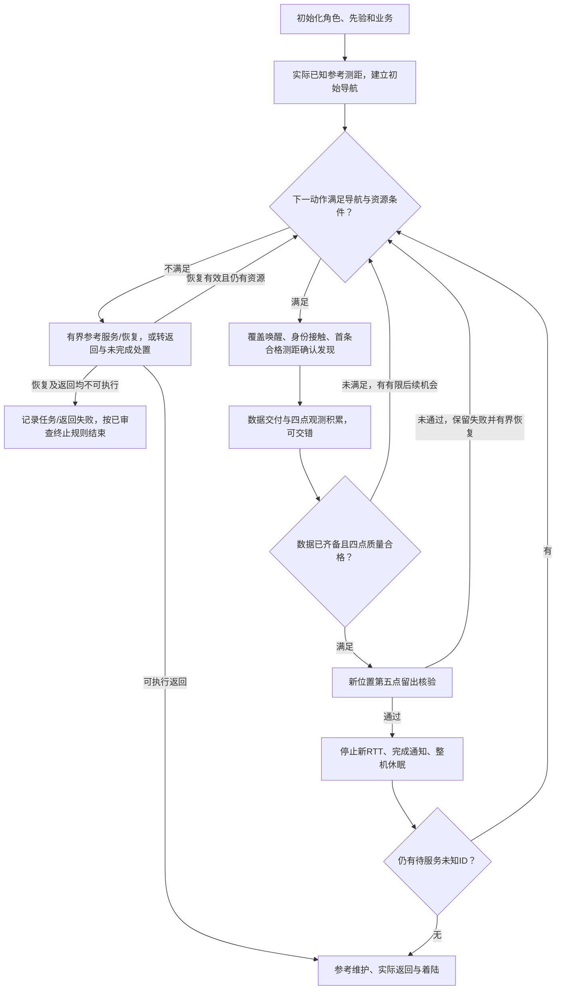

# 论文总纲：当前唯一研究规格

更新：2026-11-23。题目按用户原文保留：**基于啁啾扩频的通感一体化的协议相关技术**。最新应用场景为**GNSS不可用林区的生态监测**。本文件集中保存场景、工作流程、公式修改路线和论文安排；版本差异由Git保留，不另建第二份生效方案。论文原方法、阅读范围和借鉴边界集中在[文献与原理依据](文献与原理依据.md)。

**当前状态：最新场景与完整工作策略已保存；无线辅助导航、林区协议和新场景仿真尚未实现/验证。** MATLAB仍保留旧视觉模型，review.json保持未放行。下述“工作策略”是本轮拟采用的设计，具体帧/高程/阈值须建模审查后实现，不等于已有硬件或性能证据。

## 1. 最新确认与设计边界

| 内容 | 状态与口径 |
| --- | --- |
| 应用 | 用户已选择林区生态监测；不再采用军用、演训或库区调查作为当前任务 |
| 导航输入 | 已知位置参考终端的CSS测距辅助IMU惯性导航；任务中不使用GNSS，不使用视觉标志 |
| 定位对象 | 多个静止的未知位置生态监测终端；无人机在多个位置测距定位 |
| 平台 | 单无人机；已知参考节点数N_A、未知监测节点数N_U分别登记，不沿用旧总数暗作新角色数量 |
| 路径与交互 | 先生成参考条件支持的初始覆盖路径，沿途周期参考测距和未知节点唤醒；依当航次多终端状态有限调整 |
| 研究重点 | CSS通信、参考测距与未知节点定位的协议及服务调度；航点选择作配套 |
| 创新工作量 | 以一个候选协议/调度主方法为中心；不要求C1/C2/C3分别形成独立创新 |
| 本轮业务策略 | 以临时节点部署验收、少量数据交付及位置登记为初版工作任务；后续常态监测另行唤醒 |
| 待定模型 | 地表/树上安装高度及地形先验、参考布局与误差、实际CSS测距接口、监听窗口、载荷和各门限 |

任务选择GNSS不可用且具备可用无线参考基础设施的林区作业片段。山地/峡谷可作为具体地形实例，但不再将一般峡谷任务当作唯一业务；不推断所有林区均无GNSS。初版建议事先给定可飞行走廊及有限服务候选，不同时增加自主建图、复杂避障或新物理层波形研究。

## 2. 场景与信息来源

已有少量固定生态监测点或预先布设的无线参考终端，其位置在建设/部署时登记，具有测绘误差先验。本次调查为提高空间采样密度，新增一批临时监测节点。它们可通过无人机投送、绳降或人工快速布设，部署后在本航次内静止，但最终位置尚未准确登记。

节点主要交互温湿度等少量生态样本、采样时间、电量、自检状态及测距信息。参考终端必须实际具有所需CSS测距能力，普通监测站不能仅凭坐标已知就被当作可用测距锚点。林区部署环境传感器具有研究依据，例如[森林传感器部署研究](https://research.tudelft.nl/en/publications/sensor-delivery-in-forests-with-aerial-robots-a-new-paradigm-for-/)；该文支持部署业务，不证明本工程的无GNSS/CSS导航性能。

| 对象 | 允许在线使用的信息 | 禁止的替代或推断 |
| --- | --- | --- |
| 已知参考终端 | ID、角色、登记坐标及协方差/共同基准误差、实际收到的状态与测距 | 默认坐标无误差；把未收到的参考观测当成已完成校正 |
| 未知监测终端 | 已登记ID/数量、业务需求、实际应答；合法获得的带误差投放粗位置可作先验 | 直接读取真实落点；刻意丢弃已有粗位置制造“完全未知” |
| 无人机 | 带误差的起始位置/航向、IMU、已知参考测距、允许的地图/走廊先验 | 真位置、真姿态、未来收包结果；用未知节点真值修正导航 |
| 地形与安装高度 | 事先可获得且注明误差的先验，或实际传回的可用安装信息 | 无来源读取每个未知节点真实高程；把落在树冠的节点默认为地表 |

只有新增节点最终位置仍未达到登记要求时，后续定位才有必要。投放粗位置不能直接当成无误差终端坐标。已定位的未知节点不自动升级为导航参考，避免引入无线SLAM和循环证据。

本航次是部署验收：读取部署状态/少量样本、完成位置登记和通知，然后整机休眠。后续采样/读取在另一次唤醒任务中进行；整机休眠期间不继续环境采样，不宣称本航次实现连续生态监测。

## 3. 导航、定位与业务边界

信息链为：**已知参考坐标先验＋真实CSS参考测距→IMU辅助导航→带误差的无人机天线位置及所需联合块→未知节点多位置测距→4＋1定位核验→后续服务航线决策**。

IMU在移动、监听、通信、测距和计算期间持续传播。只有真正取得、身份匹配且通过在线有效性检查的已知参考观测，才进入导航更新。未知终端测距不反向更新无人机位姿；留出的未知测距原始成分也不得通过时钟校准等路径回灌本轮四点拟合。

一条参考距离不等于完整位置/姿态校正。参考节点布局、观测时效、运动、初始位置/航向及登记误差须联合审查；不能只凭“有若干已知节点”宣称可观。共同坐标偏差不能因增加参考节点或重复测距就独立平均掉。

高程仍待定。初版建议利用已知局部地形和节点相对地表安装高度进行水平定位化简，同时保留三维无人机导航；这尚不是已确认的平地假设。若不能提供可靠安装高度/地形先验，应改用带高程先验或三维节点模型，不能直接套用旧二维后端。


### 3.1 初始覆盖路径的生成

输入为作业区域Ω、可飞行走廊C、起降点、已知参考坐标及误差、声明的无线服务模型、IMU先验与任务资源。路径不能仅由参考坐标连线得到，也不读取未知终端真实落点。建议在给定走廊/网格上生成往返或蛇形覆盖序列π₀=(q₀,…,q_M)，只比较有限起点/方向与返回连接，不研究全局最优覆盖。

生成时执行四项检查：划分必须获得唤醒机会的覆盖单元；在路径旁标注已知参考可服务的候选位置；逐段预测无新参考观测时的导航误差增长及完整服务时间；连接有条件可执行的回程。参考候选的几何与链路是有误差模型下的预计条件，实际执行仍须收到参考测距后才更新导航。

路径中相邻参考机会之间若无法容纳必要广播/业务事务及下一参考服务，应调整路径或已知参考布设，并重新检查。不得通过清零导航误差、缩短物理包或读取未知节点真值制造可行。覆盖单元“已访问/已提供机会”与“节点已发现”分别记录，走完π₀不证明全部节点发现。

### 3.2 无线参考观测的局部原理

采用既有右乘局部误差约定δp=p_true−p_hat，R_true=R_hat Exp(δθ)。令天线杆臂为ℓ_a，参考登记坐标为a_j，则

$$
p^{ant}=p+R\ell_a,\qquad r_j^A=\|p^{ant}-a_j\|+b_j+\varepsilon_j.
$$

对参考距离d及单位方向u=(p+Rℓ_a−a_j)/d，一阶几何残差为

$$
\delta d=u^T\delta p-u^TR[\ell_a]_\times\delta\theta-u^T\delta a_j.
$$

其余速度/偏置分量通过IMU传播关联；若增广测距偏差，偏差列还需加入。坐标、时钟及设备公共项进入增广状态或统一联合输入，不能既放入导航协方差又重复作为独立测距噪声。上述是非零距离处的局部线性化，不证明完整INS可观；采用普通卡尔曼更新还须明确剩余观测噪声的独立条件。

L2的参考惯导框架与L7的误差状态约定提供基础，L5提示高程/航位误差的作用，具体对应见[文献与原理依据](文献与原理依据.md)。未知终端观测仍为r_i^U=‖p_ant−s_i‖＋误差，只用于其位置估计；参考位置与导航共同平移时距离不变，绝对误差下限须来自坐标先验，不能由4＋1消除。

## 4. 完整工作流程：唤醒、发现、导航与定位

以下S0—S10采用“初始覆盖＋周期服务＋同航次有界反馈”。这不是已实现的函数或已通过的任务验证。导航质量、参考时效、候选次数和资源上限的具体数值须在审查时冻结。

| 步骤 | 执行动作 | 输出与进入下一步的条件 |
| --- | --- | --- |
| S0 起飞前初始化 | 读两类节点清单及误差先验，按第3.1节生成初始覆盖/回程路径；初始化参考、唤醒计时器和业务/会话表 | 角色、单位、坐标系、ID/数量及会话一致；新模型尚未审查时只允许此类静态准备，不启动航次 |
| S1 建立初始参考服务 | 在起降区可服务范围内唤醒/联系已知参考终端，核对身份，执行实际CSS测距并更新导航 | 真实观测与有效几何满足首段准入；不足时有限再服务/终止，不带着理想位置盲目开始未知节点扫描 |
| S2 覆盖移动与唤醒 | 沿已审查的覆盖走廊到有限服务点；按参考/唤醒周期与第6.1节准入发送含会话、目标ID/组和相对响应安排的控制 | 终端在实际监听窗收到控制后响应；等待、无应答、冲突及重试均计时，未应答不等于不存在 |
| S3 身份接触登记 | 核对ID、角色、会话/序列和实际帧有效性，记录状态与可用业务信息 | 仅记identity_seen；参考与未知角色不能互换，身份应答本身不等于未知节点确认发现或定位完成 |
| S4 首条合格测距确认发现 | 在导航/完整事务条件满足时取得未知节点的首条合格CSS测距并关联导航快照 | identity_seen＋first_qualified_rtt才记discovered；原始观测可保留，但单条不能冒充一个已收齐同址聚合次数的空间记录 |
| S5 数据交付与观测积累 | 接收本航次样本/状态，检查业务序列、完整性和ACK；同时允许积累合法定位观测 | data_delivered与fit_progress分开维护；可交错，不要求等全部未知节点发现后才定位；数据尚未齐备时不启动最终核验 |
| S6 四点拟合与质量 | 取得4个实际不同空间位置记录，按同一导航版本重组相关输入、估计与名义区域 | 质量/数值条件合格且数据已交付才能进入S7；否则有界补点或保持后续覆盖，不以真实误差小替代在线质量 |
| S7 新位置留出核验 | 在新的不同空间位置取得第五记录，其全部原始成分不进入当前四点拟合或间接校准 | 通过才发布原四点位置估计；未通过保留原因并有限恢复，新轮仍须新留出；不无限追加测距 |
| S8 停测、通知与休眠 | 定位通过立即停止该未知ID新定位RTT，有限发送完成通知；终端实际收到后整机休眠 | 定位完成、stop_ack、真实deep_sleep分开记录；ACK丢失不重启测距、不据此认定仍醒着，也不在休眠后补传遗漏业务数据 |
| S9 选择下一动作/航点 | 综合导航质量、剩余覆盖、数据交付、缺拟合/新核验位置和返回资源，按第6.1—6.3节准入、排序及伪代码决定下一事务与有限候选 | 无人机用已有估计指导后续航线；未发现ID继续获得覆盖机会，已完成ID不再分配定位服务；回到S2或相应未完成服务 |
| S10 实际返回与结束 | 保持回程必要参考服务，执行移动、真实参考更新及着陆，停止本航次 | 不能仅凭计划到家判返回；逐节点离线核验真实误差、实际休眠及真实返回端点。未完成、无ACK、误接纳和返回失败均保留 |

S1的初始参考建立仅在启动时进行；此后参考维护贯穿S2—S10，不是只校正一次。S9不是要求所有未知节点先发现再定位；覆盖优先与边发现边定位继续保持。每次移动和无线事务前都须重查第6节的导航/资源条件。



图中的回环均受有限次数、时间和返回资源限制；没有后续机会则记录未完成并执行可行返回或已审查终止规则。完整任务成功要求所有登记未知节点的数据交付、发现/定位核验、逐终端真实误差、通知ACK、实际休眠和实际返回全部满足要求。

## 5. 唤醒与两类终端的状态策略

初版建议以周期监听窗口接收唤醒广播，建立会话后按预约时隙响应；监听周期、广播重复、时钟保护和收发切换须由设备/帧模型确定，尚未配置。首次接触的节点不能被假定提前知道无人机本次动态时隙表：先收到控制和必要安排，再按本地计时行动。普通CSS收发机完全关闭时不能仍随时收到唤醒包；深度休眠后再次唤醒可采用预定时刻或明确的额外唤醒能力，当前不宣称已实现。

| 对象 | 逻辑状态与关键规则 |
| --- | --- |
| 已知参考终端 | registered→contacted→reference_usable；失联/过期记reference_unavailable。可按预约窗口节能，但导航与回程期间保留必要可用性，不套用未知节点DONE即退出 |
| 未知监测终端 | identity_seen、discovered、data_delivered、fit_ready、verified、stop_ack分别存储；deep_sleep为环境中的真实状态，在线没有额外证据时不假装可直接读取 |
| 无人机 | 同时维护参考服务状态、未知节点业务表、覆盖进度及自身导航；覆盖/定位/通知期间始终传播IMU，不读取未来测距或真值来安排下一步 |

同一份业务数据按节点/会话/序列去重，重传仍计空口和时间。共享飞行和公共控制开销只计一次，各ID的实际测距/应答不能只计一次。唤醒、通信可达与合格测距是不同事件，不用同一个理想圆覆盖三个条件。

拟议逻辑帧为“同步/控制→参考测距→未知节点业务与测距→ACK/状态”，实际收发包及必要结果回传须按接口展开。时隙同步用于有序接入，不等于已经具备ToF精细时间基准；硬件测距引擎或可获得的射频时间戳必须先选定，不能拿操作系统计时替代。


### 5.1 两个周期与导航事件触发

参考交互以T_A限制非参考服务允许的参考年龄：t_A记录最近一次实际参考服务完成且满足导航后置条件的时刻，个别参考包的接收时刻另存；不能用无效单包重置整个参考时效。下一参考期限为d_A,period=t_A＋T_A。实际参考失败/逾期要记录并进入有限恢复，期限不保证必然收到参考观测。未知节点控制采用周期T_W，记录真实广播尝试，不把未发送/未解码的控制算成唤醒成功；到新的覆盖单元也可产生一次覆盖唤醒机会。T_W是原子事务边界上的调度目标，实际延迟单独记录；只对尚待联系/发现或会话过期的未完成ID安排唤醒，不反复唤醒已在役或已完成节点。

IMU持续传播，并以无未来参考更新的P⁻(t＋τ)预测下一完整动作及返回条件。q_nav(P)=√λ_max(P_xy)只是水平位置标准差代理，实际nav_ok还包含所需高度、姿态、几何/版本条件。预测即将越限或参考即将过期时，提前服务参考节点；只在实际收到并接受观测后做后验更新。

周期值由目标设备时序、监听配置和惯导误差预算定值，不直接照搬文献的固定驻留秒数、GPS条件或专用WuR。参考维护具有准入优先级，未知节点唤醒与业务不能同时占用单台半双工CSS收发机；控制、数据、参考测距和未知测距按实际物理包串行安排。

初版在沿途有限服务点短停执行完整无线事务，移动和等待期间IMU持续传播。周期将到时，应提前选择能按期限到达的服务点，移动/稳定时间计入预约；短停由完整事务决定，不恢复旧10 s截断。若后续选择连续运动测距，须另核对运动与时间戳对齐模型，不能沿用静止距离误差假设。

### 5.2 周期监听下的首次唤醒与接入

初版主方案不新增专用WuR。令T_L为包含设备时钟/启动不确定性后，到下一完整监听窗开始的时间上界，W_rx为保守的有效监听窗长度，T_b为一份完整控制包时长，Δ_b为广播列内相邻包起点的最大间隔。一个保守的纯定时充分条件为

$$
W_{rx}\ge\Delta_b+T_b,\qquad T_{train}\ge T_L+W_{rx}.
$$

理由是长度T_L＋W_rx内包含至少一个长度W_rx的有效接收区间；该区间开始后至下一广播包起点最多Δ_b，再经过T_b可收完一包。若按固定Δ_b发送K包，广播列实际时长为(K−1)Δ_b＋T_b，取K≥ceil((T_L＋W_rx−T_b)/Δ_b)＋1，并将取整后的实际时长计入预约。这里只给出定时重叠机会，信道、CRC、捕获或硬件失败仍可能使唤醒失败；不是接收成功率保证，亦不声称该界最紧。

重复控制包携带mission/session、序列、角色/ID清单、广播列编号、距响应阶段的剩余相对时间及会话租期。终端成功解码后据本地时钟预约响应，按新鲜序列去重；未解码者不会预知动态时隙。收到不同编号包的终端使用相应剩余时间指向同一响应阶段，其保护须计入传播、时钟速率、处理和检测抖动，不能用GNSS全局同步替代。

广播列与身份响应、首次RTT须分别预约完整时间。若广播列无法放入导航允许的间隔，不能静默截断后仍称满足唤醒条件；应改变监听/广播配置、服务位置或判当前配置不可行。若中间插入参考服务，应以新的最大Δ_b重新检查定时界。深度休眠节点不参与此首次监听假设；后续再次唤醒仍需已约定的机制。

### 5.3 会话租期和逻辑服务帧

未完成节点在会话租期内按公布窗口收发；租期到期回到已声明的周期监听状态，保留业务序列和已确认观测。无人机过期后先重新联系，不能假设一次唤醒后一直在线。最终验收后进入整机休眠，不再按未完成节点的周期监听规则参与本航次。

| 逻辑段 | 必要信息/动作 | 时序与状态规则 |
| --- | --- | --- |
| 控制/唤醒 | 会话、序列、角色、目标ID或分组、相对响应安排、租期 | 首次未同步接收依赖第5.2节广播列；动态成员只有收到控制后才生效 |
| 参考测距 | 参考ID、实际测距请求/响应、必要结果回传和设备有效标志 | 使用目标硬件支持的事务，成功才更新导航；周期/质量触发时可安排帧前或帧后参考块 |
| 身份/状态/数据 | ID、采样/数据序列、载荷、电量、自检与完整性 | 采样时间可用节点本地时间及其任务相对映射；不虚构GNSS绝对时标，采样/准备延迟也计入 |
| 未知测距 | 未知ID、事务序列、有效性与导航历元 | 形成实际合格空间记录；四点与第五点全部原始成分留出，不能间接回灌 |
| 数据ACK/完成通知 | 数据接收确认、定位后完成指令、通知ACK | 数据ACK与完成ACK分开；定位通过停新RTT，通知失败只有限通知，不重新测距 |

这是同一设备上的逻辑服务帧，控制/数据包与专用测距事务可以分别发送；是否能搭载字段按硬件确认，不承诺单一物理包双功能。模式切换、载荷、前导、回传、保护、超时、重试和计算计入费用；原始RTT完整事务不可被周期事件从中间截断。初版固定PHY配置与同址聚合次数，再研究服务分配，不同时优化所有参数。

## 6. 导航维护与下一动作/航点策略

| 优先次序 | 在线触发条件 | 拟议动作及边界 |
| --- | --- | --- |
| 0 资源与可执行性 | 下一完整事务/移动及返回预约不满足，或到达不可恢复上限 | 不再启动新服务；执行仍可行的返回。若恢复和返回均不可执行，记录失败并按已审查终止规则结束，不假设真值导航自动救回 |
| 1 参考维护 | 当前或预测至下一完整事务结束的导航质量不足、参考观测过旧、几何不合格 | 优先已知参考测距；必要时只在已知走廊的有限可达候选恢复位置服务。实际成功后才更新导航，不预先把预计收包当成已缩小协方差 |
| 2 覆盖保护 | 仍有未确认发现的登记ID或覆盖段 | 保留下一覆盖机会；允许当前/邻近服务中的数据、拟合或核验，但不让已有节点无限补测挤掉未覆盖区段，插入额度另行冻结 |
| 3 已发现节点业务 | 数据未齐、缺合格空间位置、质量不足或等待新核验 | 在导航和返回允许的有限候选中，根据数据缺口、LOCALIZE/VERIFY阶段及服务成本选择；最终核验前必须数据齐备 |
| 4 全部完成 | 所有未知节点数据、定位及有限通知流程结束，或已无有限可行服务 | 保持参考服务支持实际返回；未成功节点仍列为未完成，不将提前返回计为完整任务成功 |

每个候选包含位置、参考服务请求、未知ID、业务类型和完整预约时间，不只是一个坐标。使用已发现节点的估计及质量信息选择有用的新位置；可利用投放粗先验，但不从一个节点的位置推断其他未知节点落点。

候选范围先取已给定可飞行走廊上的有限点及允许的局部补点，集合/截断/重试上限在实现前冻结。不存在合格候选时必须输出无动作/返回，不能循环搜索直到成功。无参考观测期间只做IMU预测；参考节点坐标已知不代表无线链路当前可用。

覆盖、业务、定位和返回共享同一CSS资源；导航约束不满足时，业务时延紧迫也不能跳过导航条件。参考中断、持续丢包和测距偏差可能导致未完成甚至返回失败，这些是需要评价的结果，不用事后真值修正隐藏。


### 6.1 完整动作的准入

动作为a=(q,参考请求集合,未知节点及业务集合)，包含至q的移动和一个有界服务块。τ_a是包括唤醒/响应、必要测距/业务、切换、超时与计算的完整预约时长。令d_A(t)为参考周期期限与当前无新参考预测下最早导航越限时刻的较早者，τ_A,res为动作后下一必要参考服务的完整预约（含必要移动、准备和有限尝试），R_cond为从动作后状态按声明条件计算的返回预约，D为任务额度。非参考动作至少满足

$$
t+\tau_a+\tau_{A,res}\le d_A(t),\qquad
t+\tau_a+R_{cond}\le D,
$$

并在整个预测区间满足nav_ok、走廊和飞行约束。若τ_a已包含该次后置参考块，τ_A,res置零以免重复预约；纯返回动作走返回规则。第一式防止“业务能在参考期限前结束，但留给下一参考事务的时间已不够”。预约不是实际效率统计，不把未执行的参考块当作已发生耗时或已获得观测。

R_cond含真实参考尝试/恢复和着陆费用，不以预期收包自动保证精度。参考失败会触发有限恢复/返回重检，无法满足返回条件时保留失败。每个原子事务结束、实际包接收、导航后验或租期改变后重新准入，不按计划批量跳过中途状态变化。

参考/恢复动作使用单独的恢复适用域，不以未知节点服务的q_nav上限作为前置条件，否则会把能够改善导航的测距本身拒绝。优先尝试当前位置可联系的已知参考；任何恢复移动仍须满足其走廊/不确定性和资源约束，关联、偏差及求解条件也须有效。成功与否按实际后验判定，不用“恢复模式”跳过所有条件。计算须有声明的迭代/时间预算和超时出口，实际耗时仍计入，超时不发布位置。

### 6.2 覆盖保护与多个未知终端的联合选择

覆盖阶段保留下一骨架点：有未覆盖段且仍有未发现ID或未完成节点尚无有限初估时，补点只取当前/下一骨架点关联的有限候选；两个相邻骨架点之间初版最多插入一次已执行补点。未准入提案有单独有限尝试计数，不能反复拒绝却不推进覆盖。定位、数据和核验仍可在途中完成，不设置“发现全部才能定位”的屏障。

全部登记ID已发现且未完成节点已有有限初估，或π₀已耗尽后，解除跨区补点限制。若骨架耗尽但仍有未发现ID，只能在预先限定K_scan轮内补扫，未发现状态保留；不能把完成覆盖直接记为全部发现。K_scan、每节点重试/补点/核验上限和候选总数在实现放行前冻结。

先构造同一时刻的可行动作集合F_t。每个未知节点按互斥的主需求记为NOTICE、VERIFY、DATA、INITIAL_FIT或IMPROVE：已核验但通知未闭合者只做有限NOTICE；数据未齐者为DATA；数据已齐且质量合格者为VERIFY；缺位置/有限初估者为INITIAL_FIT；其余质量不足者为IMPROVE。实际记录可同时推进多个字段，排序不对同一节点重复领取多个阶段收益。

令N_s(a)为在合法先验和服务模型下，动作a预计能推进阶段s的节点数；Δ_geo(a)为只用于打破平局的非负几何改善代理，T_full(a)>0为完整费用估计。初版在F_t上按下列元组降序选择，再按候选ID确定性打破平局：

$$
\big(N_{NOTICE},N_{VERIFY},N_{DATA},N_{INITIAL\_FIT},
N_{IMPROVE},\Delta_{geo},-T_{full},-id\big).
$$

这是一条明确的阶段启发式，不是最优性证明。所有有机会共享该位置的未完成节点都参与统计，不直接取第一个ID。无位置估计且无合法粗先验的节点不能用隐藏落点计算可达性，继续通过覆盖机会接触；有初估者才按估计、区域/相关输入及实际联系历史评估候选。N_s和Δ_geo是预测，只有实际成功的业务/新位置才计入交付与额度。

几何代理可参考L6的局部信息指标，但不能据其满秩/增益替代Q01/V01。NOTICE次数耗尽或已完成休眠者不再贡献预计收益，不通过安排无限通知占用路径。无可行动作则有限恢复、推进剩余覆盖或返回，不能循环规划直到成功。

### 6.3 在线策略伪代码

```text
读取已知参考/未知ID、先验、走廊、资源和周期；生成π₀
在起降区取得实际参考服务；初始准入失败则有限结束
循环至完成、资源不足或所有有限恢复用尽：
    用实际IMU传播；处理真实收到的包，更新角色/数据/定位/通知表
    更新会话租期；已核验未知ID停止新RTT；预留实际返回费用
    计算下一参考期限与完整候选准入
    若含参考恢复在内均无可执行服务或到返回条件：执行可行返回，保留全部未完成状态
    若参考周期进入保留区间，或可推进的非参考动作均因参考期限被拒：
        执行一个准入的参考服务/恢复块；只用实际合格观测更新导航
    否则若当前点有未执行的覆盖唤醒机会，或仍需联系ID且唤醒周期到：
        准入后发送完整广播列和身份响应安排
        联系到的未知ID只有首条合格RTT后计发现；逐事务重新准入
    否则：
        按覆盖保护生成有限动作，对多个未知ID计算互斥阶段需求
        以第6.2节元组选择一个动作，只执行首段移动或一个完整原子事务
        数据齐备且四点质量合格后才取新的第五点核验
        通过则停新RTT并有限通知整机休眠；失败则保留原因和有限额度
    记录已执行覆盖/插入、实际有效位置、数据序列及尝试；继续重检
回程期间继续维护参考服务，真实着陆后离线核对逐节点误差与任务结果
```

周期到但不满足完整事务准入时，不先发半帧再补预算。参考期限与唤醒窗口不兼容是配置/可行性问题，应在设计审查解决，不能通过隐性额外预算或读取真值绕过。

### 6.4 对照与候选贡献

同底座基线B0采用相同π₀、PHY/帧、参考最大间隔、监听规则、候选库、4＋1/数据目标和硬资源准入，按预先固定的周期/候选顺序及未知ID轮询执行；两者均可访问同一候选库并具有必要参考恢复能力，不能为基线关闭导航/返回条件或恢复。候选B1在同一能力/资源集合中根据当前状态重排/插入，采用上述期限预留、互斥阶段联合排序和有界补点。

两者在相同初始场景上比较完整任务成功、实际字节交付/时延、参考中断、未知定位/错误接纳、有效新位置、休眠/ACK和真实返回。只有双方完整成功的配对比较完整用时；重试与未完成均保留。若需要解释增量，可再单独移除多终端联合排序，先不扩成大量消融包。

L1已存在固定＋元数据自适应路径，本题只将“参考服务期限、业务交付和未知定位阶段的同航次联合安排”作为待验证候选增量；该组合是否有新颖性和收益仍需直接近邻查新及对照，不能只由命名或单例成功断言。

## 7. 公式与章节修改路线

| 公式接口 | 后续推导工作 |
| --- | --- |
| S01 场景/信息边界（新增） | 两类节点集合、坐标系、地形/安装高度先验、投放粗位置及数据需求；已知数量/ID不等于已知落点 |
| R01 RTT与时钟（重审） | 固定实际CSS测距事务、κ=α_A/α_B约定、硬件延时/时间戳单位、回传字段；不同设备时钟和公共UAV时钟分账 |
| R02 同址聚合（复用原则） | 白噪声与公共误差分开，实际m个完整服务才成一位置，空间/时间对齐及曲率剩余不重复计入 |
| N01 IMU传播（保留主体） | 统一位置/速度/姿态/偏置与离散传播，实际等待和帧时长进入传播时间；不另研究新滤波器 |
| N02 无线参考导航（重建） | 已知终端距离观测、天线杆臂、坐标误差及交叉块、观测雅可比、有效几何、更新/注入、失联恢复与返回 |
| L01/L02 未知节点定位（改输入） | 斜距/高程模型和相关非线性似然；将新的导航、测距、地形及共享时钟输入组成联合误差账本 |
| Q01/V01 质量与4＋1（保留框架） | 新导航版本、名义区域与独立原始成分留出；参考共同误差及林区偏差不由重复平均消除；不恢复严格全局覆盖/KKT证明 |
| C01 帧与接入（重点补充） | 字段/包长、CSS符号时长、收发切换、监听/唤醒、无GNSS全局同步下的本地时隙保护和有限重试 |
| C02 业务与完成（新增） | 样本/状态载荷、完整交付和去重/ACK，数据前置于最终核验；参考与未知节点不同生命周期 |
| P01 质量反馈服务（重写） | 当前及下一事务的导航质量、参考时效、数据缺口和定位阶段驱动有限调度；航点作配套，先不联合优化所有PHY/轨迹参数 |
| T01 时间与返回（重写） | 真实事件区间、参考与未知服务费用、完整事务预约、有限失败和实际返回，不再包含视觉拍摄/恢复费用 |

N02的参考观测与L01的未知观测必须分开：前者约束无人机导航，后者定位未知节点。后续可写为r_A=‖p_ant−a_j‖＋误差、r_U=‖p_ant−s_i‖＋误差，p_ant=p＋Rℓ_a；需补齐误差项及时间定义才构成实现模型。

旧C=C_r＋GP_navGᵀ只在相应交叉项为零时适用。新导航也使用CSS测距，应先用联合输入的一阶传播C_e(x)=J_ζ(x)Σ_ζJ_ζ(x)ᵀ组织时钟/设备/导航/地形误差，再判断可简化项；已通过导航传入的位置误差不能重复添加。林区遮挡应分别影响收包与测距误差，在线不能依据隐藏NLOS真标签或真实距离筛选合格观测。

文献逐项对照见[文献与原理依据](文献与原理依据.md)。参考方法可采用[Solà误差状态资料](https://arxiv.org/abs/1711.02508)的惯导框架；CSS测距需对照[Semtech测距资料](https://www.semtech.com/products/wireless-rf/lora-connect/sx1280)及[Müller等的实际LoRa测距研究](https://digitalcollection.zhaw.ch/bitstream/11475/22769/3/2021_Mueller-etal_Outdoor-ranging-and-positioning-based-on-LoRa-modulation.pdf)。这些来源不为本林区组合参数或5 m白噪声假设背书。协议/资源层通感与同一物理包双功能的要求应明确区分，不能由题名直接推定硬件能力。

| 章节 | 新正文重心 |
| --- | --- |
| 第1章 绪论 | 林区临时生态监测需求、已有参考设施与新增节点、研究问题与贡献边界 |
| 第2章 系统与观测模型 | 两类终端、地形与信息边界、CSS测距及IMU/参考观测基础 |
| 第3章 CSS通感协议 | 唤醒发现、实际帧/事务、参考/未知服务、数据与状态、费用与失败 |
| 第4章 质量反馈调度与闭环 | 参考维护、未知定位核验、有限下一动作/航点及实际返回 |
| 第5章 仿真与适用边界 | 导航底座、单节点业务闭环、多节点公平对照、遮挡/参考中断等压力 |
| 第6章 总结 | 已验证结论、限制与后续工作；标准长推导可放附录 |

候选主方法为“导航质量约束下的CSS参考测距、业务通信与未知节点定位协同服务协议”。帧组织与质量反馈调度可以共同支撑一个主方法，是否构成创新须查新与同底座对照，不恢复三个独立创新包。

## 8. 沿用要求、参数与证据状态

继续保留逐终端真实水平误差≤20 m、实际返回误差≤3 m、4个不同拟合位置＋1个新留出位置、未知节点定位通过后停测/整机休眠、真值隔离、有限执行与失败留存。名义区域/预测核验不称严格95%或任意场景保证，不用平均RMSE替代逐节点目标。

旧物理5 m／在线5 m及物理5 m／在线10 m压力口径保留为候选，频段/设备与林区模型审查后再冻结。保守在线模型与实际噪声/NLOS变化是不同实验。旧120×80 m、18 m候选高度、2400 s额度、5/10节点及重复次数是保留输入，不自动成为新场景约束；高度、参考/未知数量和实际参考服务能力须联合诊断。32视觉标志、1 m边长、像素门槛及旧96候选不继承。

新设计标识forest_css_isac_20261123。新场景航次为0，新导航/协议模型验证为0。research_configs/baseline.json仍是唯一配置入口，但其数值明确属于旧视觉模型；project_context保存最新场景及策略状态，不伪装成新可运行配置。review.json保持mission_enabled=false，禁止以旧回归或旧评价计划验证新场景。

旧视觉实现、原总纲和旧设计由Git提交fd76b74、1229466及历史保留；[旧逐例结果](evidence/development_cases.json)与[旧视觉诊断](evidence/geometry_hypotheses.json)保持原值。既有成功、错误接纳和失败不重记为新林区结果。唯一代码仍在matlab_mvp，结果不逐例复制源码。

## 9. 下一步实施顺序与待定项

1. 先固定输入接口：地表/树上安装与高程信息、参考登记误差和布局、起始位置/航向、实际测距接口、监听能力及本航次载荷。首版推荐可解释的局部林区和给定飞行走廊，待审查后冻结，不用理想位置替代未选输入。
2. 推导并检查N01/N02参考测距辅助惯导：参考正常、几何退化、偏差和有限中断，先联合检查20 m定位与3 m返回是否存在合理物理可行条件。
3. 推导C01/C02：逐包费用、时隙/切换、重试、数据完整交付、两类终端状态及完成通知。同步时隙不替代精细测距时钟处理。
4. 重建L01/L02/Q01/V01联合输入与4＋1，完成固定输入代数/留出反例后，再在唯一工程迁移实现。
5. 公式、状态、轻量输出及实现接口审查通过后，才按project登记范围开展小型开发：参考导航→单未知节点完整业务→多未知节点；不能用模块检查冒充整任务成功。
6. 冻结后比较同底座的固定周期参考/固定资源/顺序轮询与质量反馈协议。保持相同硬件、业务、候选、质量规则、资源和未见初始场景；所有正负结果保留。完整用时只在双方完整成功的配对中比较，提前失败不计速度收益。

待定项包括：地形/安装高度模型；参考与未知数量、参考布局/先验及起始状态；林区链路、遮挡/相关偏差/连续丢包；实际CSS硬件与RTT事务；监听/保护/载荷；导航门限、时效、补点/恢复上限及返回/不可恢复终止接口。它们不妨碍保存本轮策略，但完成审查前不运行新航次。

通信指标需有实际交付字节/序列、时延和空口记录；能耗尚未建模时只报告收发/监听占用，不把空口时间称整机节能。实现仍遵守开发50 MiB/批、正式250 MiB/批、单例5 MiB、当期新增1 GiB限额；仅保留必要事件与4＋1所需联合块。

固定输入原理核对入口为[check_forest_strategy_algebra.py](research_checks/check_forest_strategy_algebra.py)，检查局部参考雅可比、共同平移不变性、误差交叉项、监听定时界和有限调度反例；数值为独立代数算例，不是新的物理参数或任务结果。

README仅作入口，文献与原理依据只维护来源和原理边界，AGENTS仅维护协作/审查规则，project('status')显示最新林区场景与策略状态。后续正文、代码和评价均围绕本文件，不同步历史稿或新增阶段目录。
