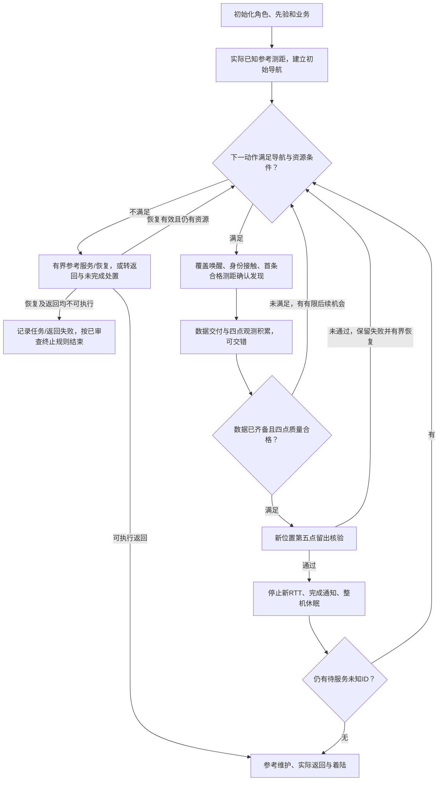

# 论文总纲：当前唯一研究规格

更新：2026-11-23。题目按用户原文保留：**基于啁啾扩频的通感一体化的协议相关技术**。最新应用场景为**GNSS不可用林区的生态监测**。本文件集中保存场景、工作流程、公式修改路线和论文安排；版本差异由Git保留，不另建第二份生效方案。

**当前状态：最新场景与完整工作策略已保存；无线辅助导航、林区协议和新场景仿真尚未实现/验证。** MATLAB仍保留旧视觉模型，review.json保持未放行。下述“工作策略”是本轮拟采用的设计，具体帧/高程/阈值须建模审查后实现，不等于已有硬件或性能证据。

## 1. 最新确认与设计边界

| 内容 | 状态与口径 |
| --- | --- |
| 应用 | 用户已选择林区生态监测；不再采用军用、演训或库区调查作为当前任务 |
| 导航输入 | 已知位置参考终端的CSS测距辅助IMU惯性导航；任务中不使用GNSS，不使用视觉标志 |
| 定位对象 | 多个静止的未知位置生态监测终端；无人机在多个位置测距定位 |
| 平台 | 单无人机；已知参考节点数N_A、未知监测节点数N_U分别登记，不沿用旧总数暗作新角色数量 |
| 研究重点 | CSS通信、参考测距与未知节点定位的协议及服务调度；航点选择作配套 |
| 创新工作量 | 以一个候选协议/调度主方法为中心；不要求C1/C2/C3分别形成独立创新 |
| 本轮业务策略 | 以临时节点部署验收、少量数据交付及位置登记为初版工作任务；后续常态监测另行唤醒 |
| 待定模型 | 地表/树上安装高度及地形先验、参考布局与误差、实际CSS测距接口、监听窗口、载荷和各门限 |

任务选择GNSS不可用且具备可用无线参考基础设施的林区作业片段。山地/峡谷可作为具体地形实例，但不再将一般峡谷任务当作唯一业务；不推断所有林区均无GNSS。初版建议事先给定可飞行走廊及有限服务候选，不同时增加自主建图、复杂避障或新物理层波形研究。

## 2. 场景与信息来源

已有少量固定生态监测点或预先布设的无线参考终端，其位置在建设/部署时登记，具有测绘误差先验。本次调查为提高空间采样密度，新增一批临时监测节点。它们可通过无人机投送、绳降或人工快速布设，部署后在本航次内静止，但最终位置尚未准确登记。

节点主要交互温湿度等少量生态样本、采样时间、电量、自检状态及测距信息。参考终端必须实际具有所需CSS测距能力，普通监测站不能仅凭坐标已知就被当作可用测距锚点。林区部署环境传感器具有研究依据，例如[森林传感器部署研究](https://research.tudelft.nl/en/publications/sensor-delivery-in-forests-with-aerial-robots-a-new-paradigm-for-/)；该文支持部署业务，不证明本工程的无GNSS/CSS导航性能。

| 对象 | 允许在线使用的信息 | 禁止的替代或推断 |
| --- | --- | --- |
| 已知参考终端 | ID、角色、登记坐标及协方差/共同基准误差、实际收到的状态与测距 | 默认坐标无误差；把未收到的参考观测当成已完成校正 |
| 未知监测终端 | 已登记ID/数量、业务需求、实际应答；合法获得的带误差投放粗位置可作先验 | 直接读取真实落点；刻意丢弃已有粗位置制造“完全未知” |
| 无人机 | 带误差的起始位置/航向、IMU、已知参考测距、允许的地图/走廊先验 | 真位置、真姿态、未来收包结果；用未知节点真值修正导航 |
| 地形与安装高度 | 事先可获得且注明误差的先验，或实际传回的可用安装信息 | 无来源读取每个未知节点真实高程；把落在树冠的节点默认为地表 |

只有新增节点最终位置仍未达到登记要求时，后续定位才有必要。投放粗位置不能直接当成无误差终端坐标。已定位的未知节点不自动升级为导航参考，避免引入无线SLAM和循环证据。

本航次是部署验收：读取部署状态/少量样本、完成位置登记和通知，然后整机休眠。后续采样/读取在另一次唤醒任务中进行；整机休眠期间不继续环境采样，不宣称本航次实现连续生态监测。

## 3. 导航、定位与业务边界

信息链为：**已知参考坐标先验＋真实CSS参考测距→IMU辅助导航→带误差的无人机天线位置及所需联合块→未知节点多位置测距→4＋1定位核验→后续服务航线决策**。

IMU在移动、监听、通信、测距和计算期间持续传播。只有真正取得、身份匹配且通过在线有效性检查的已知参考观测，才进入导航更新。未知终端测距不反向更新无人机位姿；留出的未知测距原始成分也不得通过时钟校准等路径回灌本轮四点拟合。

一条参考距离不等于完整位置/姿态校正。参考节点布局、观测时效、运动、初始位置/航向及登记误差须联合审查；不能只凭“有若干已知节点”宣称可观。共同坐标偏差不能因增加参考节点或重复测距就独立平均掉。

高程仍待定。初版建议利用已知局部地形和节点相对地表安装高度进行水平定位化简，同时保留三维无人机导航；这尚不是已确认的平地假设。若不能提供可靠安装高度/地形先验，应改用带高程先验或三维节点模型，不能直接套用旧二维后端。

## 4. 完整工作流程：唤醒、发现、导航与定位

以下S0—S10是工作策略，不是已实现的函数或已通过的任务验证。导航质量、参考时效、候选次数和资源上限的具体数值须在审查时冻结。

| 步骤 | 执行动作 | 输出与进入下一步的条件 |
| --- | --- | --- |
| S0 起飞前初始化 | 读两类节点清单、参考坐标/误差、合法投放先验、起始导航先验、走廊、业务需求和资源；约定监听/会话规则 | 角色、单位、坐标系、ID/数量及会话一致；新模型尚未审查时只允许此类静态准备，不启动航次 |
| S1 建立初始参考服务 | 在起降区可服务范围内唤醒/联系已知参考终端，核对身份，执行实际CSS测距并更新导航 | 真实观测与有效几何满足首段准入；不足时有限再服务/终止，不带着理想位置盲目开始未知节点扫描 |
| S2 覆盖移动与唤醒 | 沿已审查的覆盖走廊到有限服务点；检查导航/返回预约，发送含会话、目标ID或组及响应安排的唤醒控制 | 终端在实际监听窗收到控制后响应；等待、无应答、冲突及重试均计时，未应答不等于不存在 |
| S3 身份接触登记 | 核对ID、角色、会话/序列和实际帧有效性，记录状态与可用业务信息 | 仅记identity_seen；参考与未知角色不能互换，身份应答本身不等于未知节点确认发现或定位完成 |
| S4 首条合格测距确认发现 | 在导航/完整事务条件满足时取得未知节点的首条合格CSS测距并关联导航快照 | identity_seen＋first_qualified_rtt才记discovered；原始观测可保留，但单条不能冒充一个已收齐同址聚合次数的空间记录 |
| S5 数据交付与观测积累 | 接收本航次样本/状态，检查业务序列、完整性和ACK；同时允许积累合法定位观测 | data_delivered与fit_progress分开维护；可交错，不要求等全部未知节点发现后才定位；数据尚未齐备时不启动最终核验 |
| S6 四点拟合与质量 | 取得4个实际不同空间位置记录，按同一导航版本重组相关输入、估计与名义区域 | 质量/数值条件合格且数据已交付才能进入S7；否则有界补点或保持后续覆盖，不以真实误差小替代在线质量 |
| S7 新位置留出核验 | 在新的不同空间位置取得第五记录，其全部原始成分不进入当前四点拟合或间接校准 | 通过才发布原四点位置估计；未通过保留原因并有限恢复，新轮仍须新留出；不无限追加测距 |
| S8 停测、通知与休眠 | 定位通过立即停止该未知ID新定位RTT，有限发送完成通知；终端实际收到后整机休眠 | 定位完成、stop_ack、真实deep_sleep分开记录；ACK丢失不重启测距、不据此认定仍醒着，也不在休眠后补传遗漏业务数据 |
| S9 选择下一动作/航点 | 综合导航质量、剩余覆盖、数据交付、缺拟合/新核验位置和返回资源，按第6节决定下一事务与有限候选 | 无人机用已有估计指导后续航线；未发现ID继续获得覆盖机会，已完成ID不再分配定位服务；回到S2或相应未完成服务 |
| S10 实际返回与结束 | 保持回程必要参考服务，执行移动、真实参考更新及着陆，停止本航次 | 不能仅凭计划到家判返回；逐节点离线核验真实误差、实际休眠及真实返回端点。未完成、无ACK、误接纳和返回失败均保留 |

S1的初始参考建立仅在启动时进行；此后参考维护贯穿S2—S10，不是只校正一次。S9不是要求所有未知节点先发现再定位；覆盖优先与边发现边定位继续保持。每次移动和无线事务前都须重查第6节的导航/资源条件。

图中的回环均受有限次数、时间和返回资源限制；没有后续机会则记录未完成并执行可行返回或已审查终止规则。完整任务成功要求所有登记未知节点的数据交付、发现/定位核验、逐终端真实误差、通知ACK、实际休眠和实际返回全部满足要求。

## 5. 唤醒与两类终端的状态策略

初版建议以周期监听窗口接收唤醒广播，建立会话后按预约时隙响应；监听周期、广播重复、时钟保护和收发切换须由设备/帧模型确定，尚未配置。首次接触的节点不能被假定提前知道无人机本次动态时隙表：先收到控制和必要安排，再按本地计时行动。普通CSS收发机完全关闭时不能仍随时收到唤醒包；深度休眠后再次唤醒可采用预定时刻或明确的额外唤醒能力，当前不宣称已实现。

| 对象 | 逻辑状态与关键规则 |
| --- | --- |
| 已知参考终端 | registered→contacted→reference_usable；失联/过期记reference_unavailable。可按预约窗口节能，但导航与回程期间保留必要可用性，不套用未知节点DONE即退出 |
| 未知监测终端 | identity_seen、discovered、data_delivered、fit_ready、verified、stop_ack分别存储；deep_sleep为环境中的真实状态，在线没有额外证据时不假装可直接读取 |
| 无人机 | 同时维护参考服务状态、未知节点业务表、覆盖进度及自身导航；覆盖/定位/通知期间始终传播IMU，不读取未来测距或真值来安排下一步 |

同一份业务数据按节点/会话/序列去重，重传仍计空口和时间。共享飞行和公共控制开销只计一次，各ID的实际测距/应答不能只计一次。唤醒、通信可达与合格测距是不同事件，不用同一个理想圆覆盖三个条件。

拟议逻辑帧为“同步/控制→参考测距→未知节点业务与测距→ACK/状态”，实际收发包及必要结果回传须按接口展开。时隙同步用于有序接入，不等于已经具备ToF精细时间基准；硬件测距引擎或可获得的射频时间戳必须先选定，不能拿操作系统计时替代。

## 6. 导航维护与下一动作/航点策略

| 优先次序 | 在线触发条件 | 拟议动作及边界 |
| --- | --- | --- |
| 0 资源与可执行性 | 下一完整事务/移动及返回预约不满足，或到达不可恢复上限 | 不再启动新服务；执行仍可行的返回。若恢复和返回均不可执行，记录失败并按已审查终止规则结束，不假设真值导航自动救回 |
| 1 参考维护 | 当前或预测至下一完整事务结束的导航质量不足、参考观测过旧、几何不合格 | 优先已知参考测距；必要时只在已知走廊的有限可达候选恢复位置服务。实际成功后才更新导航，不预先把预计收包当成已缩小协方差 |
| 2 覆盖保护 | 仍有未确认发现的登记ID或覆盖段 | 保留下一覆盖机会；允许当前/邻近服务中的数据、拟合或核验，但不让已有节点无限补测挤掉未覆盖区段，插入额度另行冻结 |
| 3 已发现节点业务 | 数据未齐、缺合格空间位置、质量不足或等待新核验 | 在导航和返回允许的有限候选中，根据数据缺口、LOCALIZE/VERIFY阶段及服务成本选择；最终核验前必须数据齐备 |
| 4 全部完成 | 所有未知节点数据、定位及有限通知流程结束，或已无有限可行服务 | 保持参考服务支持实际返回；未成功节点仍列为未完成，不将提前返回计为完整任务成功 |

每个候选包含位置、参考服务请求、未知ID、业务类型和完整预约时间，不只是一个坐标。使用已发现节点的估计及质量信息选择有用的新位置；可利用投放粗先验，但不从一个节点的位置推断其他未知节点落点。

候选范围先取已给定可飞行走廊上的有限点及允许的局部补点，集合/截断/重试上限在实现前冻结。不存在合格候选时必须输出无动作/返回，不能循环搜索直到成功。无参考观测期间只做IMU预测；参考节点坐标已知不代表无线链路当前可用。

覆盖、业务、定位和返回共享同一CSS资源；导航约束不满足时，业务时延紧迫也不能跳过导航条件。参考中断、持续丢包和测距偏差可能导致未完成甚至返回失败，这些是需要评价的结果，不用事后真值修正隐藏。

## 7. 公式与章节修改路线

| 公式接口 | 后续推导工作 |
| --- | --- |
| S01 场景/信息边界（新增） | 两类节点集合、坐标系、地形/安装高度先验、投放粗位置及数据需求；已知数量/ID不等于已知落点 |
| R01 RTT与时钟（重审） | 固定实际CSS测距事务、κ=α_A/α_B约定、硬件延时/时间戳单位、回传字段；不同设备时钟和公共UAV时钟分账 |
| R02 同址聚合（复用原则） | 白噪声与公共误差分开，实际m个完整服务才成一位置，空间/时间对齐及曲率剩余不重复计入 |
| N01 IMU传播（保留主体） | 统一位置/速度/姿态/偏置与离散传播，实际等待和帧时长进入传播时间；不另研究新滤波器 |
| N02 无线参考导航（重建） | 已知终端距离观测、天线杆臂、坐标误差及交叉块、观测雅可比、有效几何、更新/注入、失联恢复与返回 |
| L01/L02 未知节点定位（改输入） | 斜距/高程模型和相关非线性似然；将新的导航、测距、地形及共享时钟输入组成联合误差账本 |
| Q01/V01 质量与4＋1（保留框架） | 新导航版本、名义区域与独立原始成分留出；参考共同误差及林区偏差不由重复平均消除；不恢复严格全局覆盖/KKT证明 |
| C01 帧与接入（重点补充） | 字段/包长、CSS符号时长、收发切换、监听/唤醒、无GNSS全局同步下的本地时隙保护和有限重试 |
| C02 业务与完成（新增） | 样本/状态载荷、完整交付和去重/ACK，数据前置于最终核验；参考与未知节点不同生命周期 |
| P01 质量反馈服务（重写） | 当前及下一事务的导航质量、参考时效、数据缺口和定位阶段驱动有限调度；航点作配套，先不联合优化所有PHY/轨迹参数 |
| T01 时间与返回（重写） | 真实事件区间、参考与未知服务费用、完整事务预约、有限失败和实际返回，不再包含视觉拍摄/恢复费用 |

N02的参考观测与L01的未知观测必须分开：前者约束无人机导航，后者定位未知节点。后续可写为r_A=‖p_ant−a_j‖＋误差、r_U=‖p_ant−s_i‖＋误差，p_ant=p＋Rℓ_a；需补齐误差项及时间定义才构成实现模型。

旧C=C_r＋GP_navGᵀ只在相应交叉项为零时适用。新导航也使用CSS测距，应先用联合输入的一阶传播C_e(x)=J_ζ(x)Σ_ζJ_ζ(x)ᵀ组织时钟/设备/导航/地形误差，再判断可简化项；已通过导航传入的位置误差不能重复添加。林区遮挡应分别影响收包与测距误差，在线不能依据隐藏NLOS真标签或真实距离筛选合格观测。

参考方法可采用[Solà误差状态资料](https://arxiv.org/abs/1711.02508)的惯导框架；CSS测距需对照[Semtech测距资料](https://www.semtech.com/products/wireless-rf/lora-connect/sx1280)及[Müller等的实际LoRa测距研究](https://digitalcollection.zhaw.ch/bitstream/11475/22769/3/2021_Mueller-etal_Outdoor-ranging-and-positioning-based-on-LoRa-modulation.pdf)。这些来源不为本林区组合参数或5 m白噪声假设背书。协议/资源层通感与同一物理包双功能的要求应明确区分，不能由题名直接推定硬件能力。

| 章节 | 新正文重心 |
| --- | --- |
| 第1章 绪论 | 林区临时生态监测需求、已有参考设施与新增节点、研究问题与贡献边界 |
| 第2章 系统与观测模型 | 两类终端、地形与信息边界、CSS测距及IMU/参考观测基础 |
| 第3章 CSS通感协议 | 唤醒发现、实际帧/事务、参考/未知服务、数据与状态、费用与失败 |
| 第4章 质量反馈调度与闭环 | 参考维护、未知定位核验、有限下一动作/航点及实际返回 |
| 第5章 仿真与适用边界 | 导航底座、单节点业务闭环、多节点公平对照、遮挡/参考中断等压力 |
| 第6章 总结 | 已验证结论、限制与后续工作；标准长推导可放附录 |

候选主方法为“导航质量约束下的CSS参考测距、业务通信与未知节点定位协同服务协议”。帧组织与质量反馈调度可以共同支撑一个主方法，是否构成创新须查新与同底座对照，不恢复三个独立创新包。

## 8. 沿用要求、参数与证据状态

继续保留逐终端真实水平误差≤20 m、实际返回误差≤3 m、4个不同拟合位置＋1个新留出位置、未知节点定位通过后停测/整机休眠、真值隔离、有限执行与失败留存。名义区域/预测核验不称严格95%或任意场景保证，不用平均RMSE替代逐节点目标。

旧物理5 m／在线5 m及物理5 m／在线10 m压力口径保留为候选，频段/设备与林区模型审查后再冻结。保守在线模型与实际噪声/NLOS变化是不同实验。旧120×80 m、18 m候选高度、2400 s额度、5/10节点及重复次数是保留输入，不自动成为新场景约束；高度、参考/未知数量和实际参考服务能力须联合诊断。32视觉标志、1 m边长、像素门槛及旧96候选不继承。

新设计标识forest_css_isac_20261123。新场景航次为0，新导航/协议模型验证为0。research_configs/baseline.json仍是唯一配置入口，但其数值明确属于旧视觉模型；project_context保存最新场景及策略状态，不伪装成新可运行配置。review.json保持mission_enabled=false，禁止以旧回归或旧评价计划验证新场景。

旧视觉实现、原总纲和旧设计由Git提交fd76b74、1229466及历史保留；[旧逐例结果](evidence/development_cases.json)与[旧视觉诊断](evidence/geometry_hypotheses.json)保持原值。既有成功、错误接纳和失败不重记为新林区结果。唯一代码仍在matlab_mvp，结果不逐例复制源码。

## 9. 下一步实施顺序与待定项

1. 先固定输入接口：地表/树上安装与高程信息、参考登记误差和布局、起始位置/航向、实际测距接口、监听能力及本航次载荷。首版推荐可解释的局部林区和给定飞行走廊，待审查后冻结，不用理想位置替代未选输入。
2. 推导并检查N01/N02参考测距辅助惯导：参考正常、几何退化、偏差和有限中断，先联合检查20 m定位与3 m返回是否存在合理物理可行条件。
3. 推导C01/C02：逐包费用、时隙/切换、重试、数据完整交付、两类终端状态及完成通知。同步时隙不替代精细测距时钟处理。
4. 重建L01/L02/Q01/V01联合输入与4＋1，完成固定输入代数/留出反例后，再在唯一工程迁移实现。
5. 公式、状态、轻量输出及实现接口审查通过后，才按project登记范围开展小型开发：参考导航→单未知节点完整业务→多未知节点；不能用模块检查冒充整任务成功。
6. 冻结后比较同底座的固定周期参考/固定资源/顺序轮询与质量反馈协议。保持相同硬件、业务、候选、质量规则、资源和未见初始场景；所有正负结果保留。完整用时只在双方完整成功的配对中比较，提前失败不计速度收益。

待定项包括：地形/安装高度模型；参考与未知数量、参考布局/先验及起始状态；林区链路、遮挡/相关偏差/连续丢包；实际CSS硬件与RTT事务；监听/保护/载荷；导航门限、时效、补点/恢复上限及返回/不可恢复终止接口。它们不妨碍保存本轮策略，但完成审查前不运行新航次。

通信指标需有实际交付字节/序列、时延和空口记录；能耗尚未建模时只报告收发/监听占用，不把空口时间称整机节能。实现仍遵守开发50 MiB/批、正式250 MiB/批、单例5 MiB、当期新增1 GiB限额；仅保留必要事件与4＋1所需联合块。

README仅作入口，AGENTS仅维护协作/审查规则，project('status')显示最新林区场景与策略状态。后续正文、代码和评价均围绕本文件，不同步历史稿或新增阶段目录。
